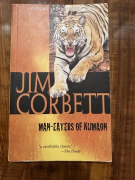

# Man-Eaters of Kumaon
**Author:** Jim Corbett | **Published:** 1944

---

## Summary

*Man-Eaters of Kumaon* (Oxford University Press, 1944) collects a series of stories, among them 'The Champawat Man-Eater', 'The Chowgarh Tigers', 'The Mohan Man-Eater', 'The Kanda Man-Eater' and 'The Thak Man-Eater', in which Corbett, often alone and on foot, tracks tigers that had killed villagers across the hill districts of Kumaon. He explains how tigers became man-eaters, usually through wounds or old age that prevented them from hunting normal prey, and describes reading tracks, alarm calls of birds and deer, and other signs of the jungle.

Interspersed with the hunts are gentler pieces, such as stories of his dog Robin, a tiger known as the Bachelor of Powalgarh, and fishing. Throughout, Corbett writes with affection for the hill people who lived under the threat of these animals and with respect for the tiger itself. In later life he became a voice for conservation, and India's first national park, Corbett National Park, was renamed in his honour.

---

## Critical Takeaways

- **Genre-defining:** Critics and readers consider it the archetype of the man-eater narrative, praised for its plain, suspenseful prose and lack of bravado.
- **Jungle lore:** Reviewers value Corbett's naturalist's eye and his detailed knowledge of animal behaviour, which give the book lasting interest beyond its adventure.
- **Humanity:** His sympathy for the villagers of Kumaon and his reluctance to kill except when necessary are frequently cited as the core of his appeal.
- **Colonial context:** Modern readers note the book's colonial setting and the figure of the white hunter-saviour, though Corbett is widely regarded as respectful of and respected by local people.
- **Conservation legacy:** The book's popularity helped make Corbett an enduring figure in Indian conservation; it sold widely in Britain and America and was adapted as the 1948 film *Man-Eater of Kumaon*.

---

## My Takeaways

_To be written — Vishwas's personal takeaways._

---

## Footnotes

- [Wikipedia: Man-Eaters of Kumaon](https://en.wikipedia.org/wiki/Man-Eaters_of_Kumaon)
- [Wikipedia: Jim Corbett](https://en.wikipedia.org/wiki/Jim_Corbett)
- [Goodreads](https://www.goodreads.com/search?q=Man-Eaters+of+Kumaon+Jim+Corbett)
