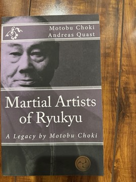

# Martial Artists of Ryukyu: A Legacy by Motobu Choki
**Author:** Motobu Choki (translated by Andreas Quast) | **Published:** 1932

---

## Summary

Motobu Choki (1870–1944) came from an aristocratic Okinawan family and became one of the best-known and most controversial karate fighters of his era, known for testing his skill in real fights. In 1932 he published *Watashi no Karate-jutsu* ("My Art and Skill of Karate").

*Martial Artists of Ryukyu* is a translation by the karate historian Andreas Quast of material from that book in which Motobu records what he learned about the martial artists of Shuri, the royal capital, and other places: their characters, fighting abilities, and stories told about them.

The small book serves as a primary source on how the generation that brought karate from Okinawa to mainland Japan remembered the masters before them.

---

## Critical Takeaways

- **Primary source:** Its main value is preserving Motobu's first-hand recollections of nineteenth-century Okinawan martial artists in English.
- **Careful translation:** Quast is known as a researcher of Ryukyuan martial history, and his translations are generally valued for scholarly care.
- **Anecdotal nature:** Readers should note that the content is personal recollection and hearsay rather than documented history.
- **Little published criticism exists:** It is a small, independently published translation discussed mainly among karate historians.

---

## My Takeaways

_To be written — Vishwas's personal takeaways._

---

## Footnotes

- [Blackwell's — Martial Artists of Ryukyu](https://blackwells.co.uk/bookshop/product/Martial-Artists-of-Ryukyu-by-Choki-Motobu-author-Andreas-Quast-translator/9781542453462)
- [Wikipedia — Motobu Chōki](https://en.wikipedia.org/wiki/Motobu_Ch%C5%8Dki)
- [Ryukyu Bugei (Andreas Quast)](https://ryukyu-bugei.com/)
