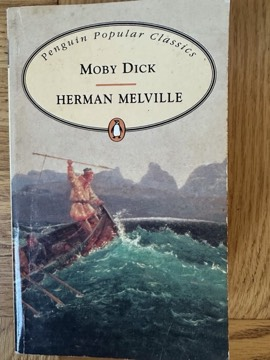

# Moby-Dick; or, The Whale
**Author:** Herman Melville | **Published:** 1851 | **Status:** partially read

---

## Summary

*Moby-Dick* opens with "Call me Ishmael", as the narrator, restless on land, signs on to the whaling ship Pequod out of Nantucket, together with Queequeg, a harpooner from the South Seas with whom he forms a close friendship. Once at sea, Captain Ahab reveals that the voyage's true purpose is revenge on Moby Dick, the great white sperm whale that destroyed his leg.

The narrative alternates between the story of the voyage and long digressions on cetology, the techniques and economics of whaling, and philosophical and religious reflection. The crew, including the cautious first mate Starbuck, the harpooners and the boy Pip, are drawn into Ahab's obsession. After a three-day chase, the whale destroys the Pequod; Ishmael alone survives, floating on Queequeg's coffin.

The novel engages questions of fate, free will, the knowability of nature and God, and the meaning of the whale's whiteness, and its formal experimentation anticipates later modernist fiction.

---

## Critical Takeaways

- **Initial failure, later canonization:** Poorly received and commercially unsuccessful in 1851, the novel was rediscovered in the 1920s Melville revival and is now a central American classic.
- **Symbolic richness:** Critics have read the whale and Ahab's quest as allegories of everything from God and nature to American expansion and capitalism.
- **Formal experiment:** Its mix of genres, chapters written as drama, and encyclopedic digressions are seen as innovative, though many readers find the cetology chapters a barrier.
- **Shakespearean influence:** Scholars note the influence of Shakespeare, especially *King Lear*, on Ahab and the novel's language.
- **Multicultural crew:** Critics highlight the Pequod's racially diverse crew and Ishmael and Queequeg's friendship as notable for its time.

---

## My Takeaways

_To be written — Vishwas's personal takeaways._

---

## Footnotes

- [Wikipedia — Moby-Dick](https://en.wikipedia.org/wiki/Moby-Dick)
- [Wikipedia — Herman Melville](https://en.wikipedia.org/wiki/Herman_Melville)
- [Goodreads — Moby-Dick](https://www.goodreads.com/search?q=Moby-Dick+Herman+Melville)
