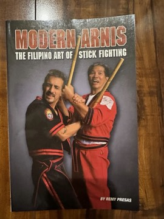

# Modern Arnis: The Filipino Art of Stick Fighting
**Author:** Remy Presas | **Published:** 1983

---

## Summary

Remy Presas (1936–2001) developed Modern Arnis by combining traditional Filipino stick-fighting methods with elements of Japanese martial arts, with the aim of preserving and popularizing arnis in the Philippines and abroad. *Modern Arnis: The Filipino Art of Stick Fighting*, published by Ohara Publications, is his principal English-language manual.

The book introduces the history of arnis, the basic strikes and angles of attack, blocks, footwork and stances, and then moves to single-stick and double-stick (sinawali) drills, disarming techniques and counters. A characteristic idea is that the same movements apply whether one holds a stick, a blade or nothing, so stick techniques are shown translating into empty-hand self-defense.

It is illustrated throughout with photo sequences of Presas and his students demonstrating techniques.

---

## Critical Takeaways

- **Historical importance:** The book is regarded as a key text in spreading Filipino martial arts in the United States in the 1980s.
- **Practical manual:** Readers note it as a solid photographic reference for basic Modern Arnis curriculum.
- **Limited depth:** Some practitioners consider it introductory, with the flow and drills of the art better learned in person.
- **Limited critical coverage:** Beyond martial-arts readership, the book has received little formal review.

---

## My Takeaways

_To be written — Vishwas's personal takeaways._

---

## Footnotes

- [Wikipedia — Remy Presas](https://en.wikipedia.org/wiki/Remy_Presas)
- [Wikipedia — Modern Arnis](https://en.wikipedia.org/wiki/Modern_Arnis)
- [Goodreads — Modern Arnis](https://www.goodreads.com/search?q=Modern+Arnis+Remy+Presas)
