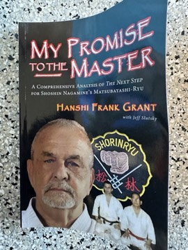

# My Promise to the Master: A Comprehensive Analysis of the Next Step for Shoshin Nagamine's Matsubayashi-Ryu
**Author:** Frank Grant (with Jeff Slutsky)

---

## Summary

Frank Grant was among the early Americans to train in Shoshin Nagamine's Matsubayashi-ryū, the Okinawan Shorin-ryu lineage Nagamine set out in *The Essence of Okinawan Karate-Do*. Written with Jeff Slutsky, this book presents itself as the fulfilment of a promise to Nagamine to take the style to 'the next step': passing on the details and nuances the Master taught him in person but did not include in his own book.

The bulk of the book is a kata-by-kata breakdown: basics, Fukyugata, the Pinan series, Naihanchi, Ananku, Wankan, Rohai, Wanshu, Passai, Gojushiho, Chinto and Kusanku, followed by the Yakusoku Kumite paired forms and supplemental training. Its distinctive feature is sequences of high-resolution stop-action photographs paired with Grant's commentary, aimed at showing the transitional moves within kata that standard step-diagrams leave out.

---

## Critical Takeaways

- **Practitioner's reference:** This is a self-published technical manual written for Matsubayashi students; little published criticism exists beyond endorsements and reader reviews within the karate community.
- **Photographic detail:** Endorsers from the Matsubayashi community, including Jerry Figgiani and Kevin Gurganus, praise the stop-action photography for revealing transitions within kata.
- **Complement to Nagamine:** It is best understood as a companion to Nagamine's own *The Essence of Okinawan Karate-Do*, extending rather than replacing it.
- **Lineage perspective:** As with most lineage manuals, its interpretations reflect one teacher's line of transmission, and practitioners in other Matsubayashi organisations may perform details differently.

---

## My Takeaways

_To be written — Vishwas's personal takeaways._

---

## Footnotes

- [Goodreads — My Promise to the Master](https://www.goodreads.com/search?q=My+Promise+to+the+Master+Frank+Grant)
- [Wikipedia — Matsubayashi-ryū](https://en.wikipedia.org/wiki/Matsubayashi-ry%C5%AB)
- [Wikipedia — Shōshin Nagamine](https://en.wikipedia.org/wiki/Sh%C5%8Dshin_Nagamine)
