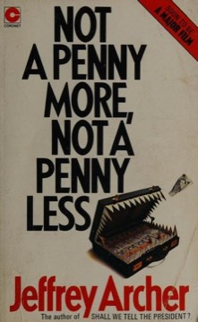

# Not a Penny More, Not a Penny Less
**Author:** Jeffrey Archer | **Published:** 1976

---

## Summary

Harvey Metcalfe, a self-made, unscrupulous American businessman, promotes shares in Prospecta Oil, a company that supposedly has struck oil in the North Sea. Four investors are ruined when the shares collapse: Stephen Bradley, an American mathematics professor at Oxford; Robin Oakley, a Harley Street doctor; Jean-Pierre Lamanns, a French art dealer; and Lord James Brigsley, an English aristocrat.

At Bradley's instigation, the four agree to recover their combined losses, not a penny more and not a penny less, by each devising a scheme that exploits Metcalfe's weaknesses and interests, which take them from the art world to Monte Carlo, Wimbledon and Oxford.

Archer wrote the novel after losing most of his money in a fraudulent investment that left him near bankruptcy and caused him to leave Parliament. It was adapted for BBC radio and television.

---

## Critical Takeaways

- **Caper pleasures:** Reviewers enjoyed the ingenious, light-hearted cons and the satisfying sense of revenge.
- **Autobiographical spark:** Critics often note the book's origin in Archer's own financial disaster.
- **Thin characters:** The four victims are lightly sketched and largely interchangeable for some readers.
- **Plot mechanics:** It established Archer's strengths in twisty plotting and his weakness in prose style.
- **Enduring popularity:** It remains one of his best-known and most-read books.

---

## My Takeaways

_To be written — Vishwas's personal takeaways._

---

## Footnotes

- [Wikipedia: Not a Penny More, Not a Penny Less](https://en.wikipedia.org/wiki/Not_a_Penny_More,_Not_a_Penny_Less)
- [Goodreads](https://www.goodreads.com/search?q=Not+a+Penny+More+Not+a+Penny+Less+Jeffrey+Archer)
