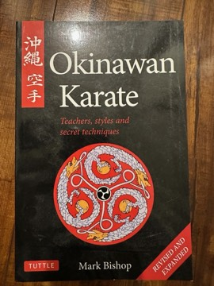

# Okinawan Karate: Teachers, Styles and Secret Techniques
**Author:** Mark Bishop | **Published:** 1989

---

## Summary

Mark Bishop, a British karateka, lived and trained in Okinawa in the 1980s and drew on that experience for *Okinawan Karate: Teachers, Styles and Secret Techniques*, first published in 1989 and later reissued by Tuttle.

The book surveys the history of karate in Okinawa and then works through its styles: the Naha-te derived Goju-ryu and the Uechi-ryu lineage, the Shuri-te derived Shorin-ryu branches (including Kobayashi, Matsubayashi and Shobayashi), and smaller or private systems that had been little documented in English, such as Motobu-ryu and various family arts. For each it describes key teachers, characteristic kata and training methods.

Bishop also records interviews and observations of teachers then active on the island, giving the book value as a snapshot of the Okinawan karate world of that period.

---

## Critical Takeaways

- **Valuable survey:** Practitioners have long regarded it as one of the most useful single-volume English overviews of Okinawan styles and teachers.
- **First-hand material:** Reviewers note the value of Bishop's direct contact with Okinawan teachers of the time.
- **Historical claims:** Some historians caution that parts of the history rely on oral tradition and have been revised by later research.
- **Limited formal criticism:** Its reception is largely within the martial-arts community.

---

## My Takeaways

_To be written — Vishwas's personal takeaways._

---

## Footnotes

- [Wikipedia — Okinawan martial arts](https://en.wikipedia.org/wiki/Okinawan_martial_arts)
- [Goodreads — Okinawan Karate](https://www.goodreads.com/search?q=Okinawan+Karate+Teachers+Styles+Mark+Bishop)
