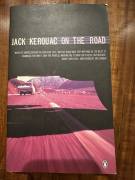

# On the Road
**Author:** Jack Kerouac | **Published:** 1957

---

## Summary

Sal Paradise, a young writer in New York, is drawn into the orbit of Dean Moriarty, a charismatic, fast-talking drifter from Denver. Across several journeys between 1947 and 1950 they hitchhike, drive and bus across the continent, to Denver, San Francisco, Los Angeles, New Orleans and finally Mexico City, chasing jazz, women, drugs, conversation and a feeling of 'IT'. Dean's energy is intoxicating but also destructive: he abandons wives and friends, and by the end Sal, settled with a new love in New York, watches him walk away into the cold.

Kerouac famously typed a draft on a continuous scroll in 1951, though the published novel was revised over several years. The characters are thinly veiled versions of Kerouac, Cassady, Allen Ginsberg (Carlo Marx), William S. Burroughs (Old Bull Lee) and others. Gilbert Millstein's rave review in *The New York Times* made the book an instant sensation.

---

## Critical Takeaways

- **Voice of a generation:** Critics see it as the key Beat text, capturing a postwar disaffection with conformity and a search for authenticity through movement and experience.
- **Prose style:** Its long, breathless, jazz-influenced sentences were praised as liberating and dismissed by others (Truman Capote's 'that's not writing, that's typing' is the most quoted jibe).
- **Romanticised marginality:** Later critics note that the book romanticises poverty and Black and Mexican life from the vantage of white male freedom.
- **Treatment of women:** Women in the novel are mostly peripheral and frequently abandoned, a point central to feminist reassessments.
- **Melancholy undertow:** Many readers emphasise that beneath the exuberance the book is elegiac, ending in loss and the fading of Dean's spell.

---

## My Takeaways

_To be written — Vishwas's personal takeaways._

---

## Footnotes

- [Wikipedia — On the Road](https://en.wikipedia.org/wiki/On_the_Road)
- [Wikipedia — Jack Kerouac](https://en.wikipedia.org/wiki/Jack_Kerouac)
- [Goodreads — On the Road](https://www.goodreads.com/search?q=On+the+Road+Jack+Kerouac)
