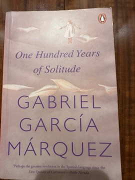

# One Hundred Years of Solitude
**Author:** Gabriel García Márquez | **Published:** 1967

---

## Summary

José Arcadio Buendía and his wife Úrsula Iguarán found Macondo in a swamp, and the novel follows their descendants, repeatedly named José Arcadio and Aureliano, through love, madness, war and solitude. Colonel Aureliano Buendía fights thirty-two failed uprisings; foreigners bring a banana company, and a strike ends in a massacre of workers that the town is then made to forget; a rain lasting nearly five years ruins Macondo. The family's history repeats in cycles until the last Aureliano deciphers the gypsy Melquíades's parchments, which foretold everything, as a whirlwind wipes the town away.

Published in Buenos Aires in 1967, the novel blends the miraculous and the mundane in an unhurried, deadpan voice modelled on the storytelling of García Márquez's grandmother. It mirrors the history of Colombia and of Latin America, including the 1928 banana massacre, and was central to García Márquez's 1982 Nobel Prize.

---

## Critical Takeaways

- **Magical realism:** Critics see it as the defining work of magical realism, where the supernatural is narrated with the same matter-of-factness as the everyday.
- **History and memory:** The banana massacre and its official denial are read as a critique of imperialism and the erasure of history.
- **Cyclical time:** The repetition of names and fates is widely discussed as an image of history condemned to repeat itself and of solitude as inherited fate.
- **Global influence:** It is credited with bringing Latin American literature to a world audience and influencing writers from Salman Rushdie to Toni Morrison.
- **Density and genealogy:** Many readers find the repetitive names and sprawling family tree challenging, though critics see the confusion as deliberate.

---

## My Takeaways

_To be written — Vishwas's personal takeaways._

---

## Footnotes

- [Wikipedia — One Hundred Years of Solitude](https://en.wikipedia.org/wiki/One_Hundred_Years_of_Solitude)
- [Wikipedia — Gabriel García Márquez](https://en.wikipedia.org/wiki/Gabriel_Garc%C3%ADa_M%C3%A1rquez)
- [Goodreads — One Hundred Years of Solitude](https://www.goodreads.com/search?q=One+Hundred+Years+of+Solitude+Garcia+Marquez)
