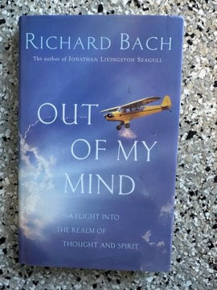

# Out of My Mind: The Discovery of Saunders-Vixen
**Author:** Richard Bach | **Published:** 1999

---

## Summary

Richard Bach's *Out of My Mind* is a short parable, a little over a hundred pages and illustrated, in the vein of his earlier *Jonathan Livingston Seagull* and *Illusions*. Its narrator, a pilot, is wrestling with a small practical problem — a door latch on his airplane that will not stay shut — when designs begin arriving in his mind as if from somewhere else.

Following those designs, and an intriguing figure who appears in one of them, draws him into a parallel world: the Saunders-Vixen Aircraft Company in England around 1923. The story uses this crossing to explore Bach's recurring themes — that imagination is a real channel to other possibilities, that inspiration may come from beyond the self, and that flying is a metaphor for freedom of mind.

---

## Critical Takeaways

- **Bach's later style:** The book continues the spiritual-fable mode of his best-known works, with flight as the governing metaphor.
- **Mixed reception:** *Publishers Weekly* was harsh, judging it likely to please Bach fans and small-plane enthusiasts but calling it simplistic and strained in its reach for profundity.
- **Slight but personal:** Readers sympathetic to Bach tend to value it as a light, whimsical meditation on creativity rather than a substantial novel.
- **Aviation detail:** Its affection for early aircraft design and the culture of 1920s British aviation gives it a distinct flavour among his books.

---

## My Takeaways

_To be written — Vishwas's personal takeaways._

---

## Footnotes

- [Publishers Weekly review](https://www.publishersweekly.com/9780688172961)
- [Wikipedia: Richard Bach](https://en.wikipedia.org/wiki/Richard_Bach)
- [Goodreads](https://www.goodreads.com/search?q=Out+of+My+Mind+Richard+Bach)
