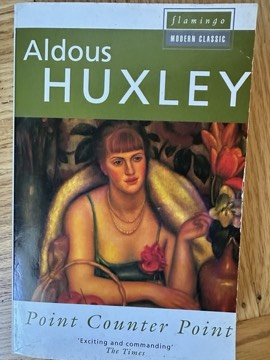

# Point Counter Point
**Author:** Aldous Huxley | **Published:** 1928

---

## Summary

*Point Counter Point* moves among dozens of characters in 1920s London: the scientist Lord Edward Tantamount and his worldly wife, the journalist Walter Bidlake caught between his pregnant mistress Marjorie and the predatory Lucy Tantamount, the novelist Philip Quarles and his neglected wife Elinor, the sanctimonious editor Burlap, the dissolute Spandrell, and the artist Mark Rampion, who preaches a philosophy of balanced, embodied living. Their stories are cut together in short, alternating scenes, and the plot builds toward the political murder of the fascist leader Everard Webley and Spandrell's own self-destruction.

The title and the method come from music: Quarles's notebook speculates about a novel that would work like a Bach fugue, with the same theme heard in different voices and keys, and Huxley's book tries to do exactly that, setting characters' ideas about sex, science, religion and politics against one another. Contemporary readers recognised real people behind several figures, most famously D. H. Lawrence in Rampion and John Middleton Murry in Burlap, which gave the book a roman-à-clef notoriety alongside its intellectual reputation.

---

## Critical Takeaways

- **Novel of ideas:** Critics regard it as the fullest example of Huxley's early mode, in which characters function largely as carriers of intellectual positions; admirers find this exhilarating, detractors find the characters thin and the talk overlong.
- **Musical form:** The contrapuntal structure and Quarles's notebook commentary are often discussed as an early modernist experiment in self-conscious fiction, anticipating later metafictional techniques.
- **Roman à clef:** The thinly disguised portraits of Lawrence, Murry and others drew attention at publication and remain a staple of scholarly commentary on the book.
- **Satire of the intelligentsia:** Reviewers note the novel's sharp, often bleak picture of an educated class that is clever but emotionally disconnected, with Rampion's Lawrentian ideal of wholeness as its tentative counterweight.
- **Reception:** It was a commercial and critical success in 1928 and is generally ranked among Huxley's major novels, though usually behind *Brave New World* in lasting popularity.

---

## My Takeaways

_To be written — Vishwas's personal takeaways._

---

## Footnotes

- [Wikipedia: Point Counter Point](https://en.wikipedia.org/wiki/Point_Counter_Point)
- [Wikipedia: Aldous Huxley](https://en.wikipedia.org/wiki/Aldous_Huxley)
- [Goodreads](https://www.goodreads.com/search?q=Point+Counter+Point+Aldous+Huxley)
