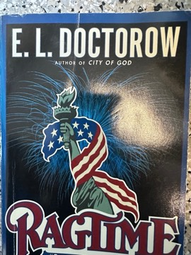

# Ragtime
**Author:** E. L. Doctorow | **Published:** 1975

---

## Summary

In New Rochelle, a prosperous family known only as Father, Mother, Mother's Younger Brother and the Little Boy find their world upended when Mother takes in a Black infant and his mother, Sarah. Sarah's lover, the ragtime pianist Coalhouse Walker Jr., is humiliated by racist volunteer firemen who wreck his Model T; denied justice, he turns to armed revolt and occupies J. P. Morgan's library. Meanwhile Tateh, a Jewish immigrant silhouette artist from the Lower East Side, rises from poverty to become a film director. Their stories intersect with appearances by Houdini, Evelyn Nesbit, Emma Goldman, Booker T. Washington and others.

Written in short, declarative sentences that mimic the syncopated rhythm of ragtime, the novel treats history as something to be imagined rather than merely recorded. Coalhouse's story is adapted from Heinrich von Kleist's *Michael Kohlhaas*. It was filmed by Miloš Forman in 1981 and became a Broadway musical in 1998.

---

## Critical Takeaways

- **Blending fact and fiction:** Critics see its freewheeling invention around real people as both its brilliance and its controversy, raising questions about novelists' licence with history.
- **Race and justice:** Coalhouse Walker's story is read as a powerful indictment of American racism and of the limits of legal redress.
- **Style:** Its clipped, rhythmic prose is widely admired as a formal analogue to ragtime music.
- **Social panorama:** It is praised for capturing the energies and inequalities of early twentieth-century America: immigration, labour unrest, celebrity and new technologies.
- **Distance from characters:** Some reviewers find its archetypal, nameless characters emotionally distant.

---

## My Takeaways

_To be written — Vishwas's personal takeaways._

---

## Footnotes

- [Wikipedia — Ragtime (novel)](https://en.wikipedia.org/wiki/Ragtime_(novel))
- [Wikipedia — E. L. Doctorow](https://en.wikipedia.org/wiki/E._L._Doctorow)
- [Goodreads — Ragtime](https://www.goodreads.com/search?q=Ragtime+Doctorow)
