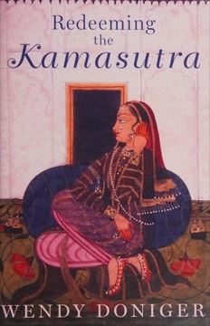

# Redeeming the Kamasutra
**Author:** Wendy Doniger | **Published:** 2016

---

## Summary

*Redeeming the Kamasutra* (Oxford University Press, 2016) collects and reworks Doniger's essays on the third-century text attributed to Vatsyayana. She places the *Kamasutra* in the framework of the three aims of life, dharma (duty), artha (wealth and power) and kama (pleasure), and argues that it is a work of urbane social science concerned with the life of the cultivated man-about-town, his household, courtship, marriage, and relations with courtesans, of which the sexual positions are only a small part.

Doniger emphasises the text's treatment of women: it discusses female pleasure and consent, gives women voices and arguments of their own, and is unusually aware of power and deception in relationships. She also traces the book's reception history, from its heavily adapted 1883 English version by Richard Burton and F. F. Arbuthnot, which she argues distorted it, to its use and suppression in modern India, presenting the text as evidence of a more open and pluralistic strand of pre-modern Indian culture.

---

## Critical Takeaways

- **Beyond the sex manual:** Reviewers credit the book with effectively making the case that the *Kamasutra* is a text about the art of living, politics of the household and social manners as much as erotics.
- **Women's agency:** Doniger's reading of the text as relatively attentive to female desire and consent is the book's most distinctive argument; some scholars think it reads modern concerns too generously into an elite, male-oriented text.
- **Reception history:** Her critique of the Burton-Arbuthnot translation and of colonial and nationalist attitudes to Indian sexuality is widely regarded as illuminating.
- **Accessibility:** Critics describe it as lively and readable for a general audience, though partly repetitive since it draws on earlier essays and her introduction to the Doniger-Kakar translation.
- **Polarised context:** As with Doniger's other work, its reception in India has been split between admiration for its scholarship and hostility from those who object to her psychoanalytic and sexual readings of Hindu traditions.

---

## My Takeaways

_To be written — Vishwas's personal takeaways._

---

## Footnotes

- [Wikipedia: Wendy Doniger](https://en.wikipedia.org/wiki/Wendy_Doniger)
- [Wikipedia: Kama Sutra](https://en.wikipedia.org/wiki/Kama_Sutra)
- [Goodreads](https://www.goodreads.com/search?q=Redeeming+the+Kamasutra+Wendy+Doniger)
