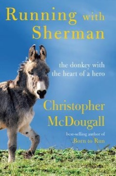

# Running with Sherman: The Donkey with the Heart of a Hero
**Author:** Christopher McDougall | **Published:** 2019

---

## Summary

After moving to rural Lancaster County, Pennsylvania, Christopher McDougall takes in a donkey, Sherman, who arrives in terrible condition from a hoarding situation. Advised that a donkey needs a purpose and a herd to recover, McDougall decides to train Sherman for burro racing, the Colorado mountain sport in which runners and donkeys race together over long courses.

The narrative follows the training, the recruitment of neighbors and friends (including a local runner and Amish neighbors) into the project, and the people McDougall meets in the burro-racing world. Along the way he explores the history of donkeys and the sport, and returns to themes from *Born to Run*: the communal, playful roots of running and its healing potential.

The book is lighter and more personal than his earlier work, closer to a heartwarming memoir than to an argument about human evolution.

---

## Critical Takeaways

- **Warm reception:** Reviewers generally found it charming and feel-good, with Sherman's recovery giving it an emotional core.
- **Lighter than Born to Run:** Critics noted it lacks the ambition and argumentative punch of McDougall's earlier bestseller.
- **Digressive structure:** Some readers found the many side stories and character sketches diluted the main narrative.
- **Animals and healing:** The book is praised for its depiction of how caring for an animal can draw a community together.
- **Running culture:** It introduces general readers to the little-known sport of pack-burro racing.

---

## My Takeaways

_To be written — Vishwas's personal takeaways._

---

## Footnotes

- [Wikipedia: Christopher McDougall](https://en.wikipedia.org/wiki/Christopher_McDougall)
- [Goodreads](https://www.goodreads.com/search?q=Running+with+Sherman+Christopher+McDougall)
