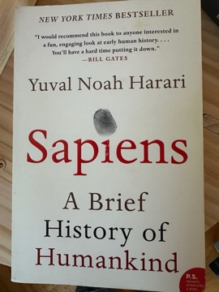

# Sapiens: A Brief History of Humankind
**Author:** Yuval Noah Harari | **Published:** 2011

---

## Summary

*Sapiens*, first published in Hebrew in 2011 and in English in 2014, surveys some 70,000 years of human history. Harari argues that what set Homo sapiens apart from other human species was a Cognitive Revolution that allowed people to talk about things that do not physically exist, and therefore to cooperate flexibly in large numbers around shared myths. The Agricultural Revolution, in his account, increased the total amount of food and population but made the lives of most individuals harder, more confined and less healthy than those of foragers. Money, empires and universal religions then unified humankind into ever larger networks.

The last part of the book treats the Scientific Revolution, driven by an admission of ignorance and fused with imperialism and capitalism, as the force that has given humans unprecedented power. Harari closes by asking whether this power has made people happier, and by speculating that biotechnology and artificial intelligence may soon transform or replace Homo sapiens, themes he developed in *Homo Deus* and *21 Lessons for the 21st Century*.

---

## Critical Takeaways

- **Big-picture synthesis:** Admirers praise its sweep, clarity and provocative framing, and it was championed by prominent public readers, contributing to sales in the millions and translation into dozens of languages.
- **Shared fictions:** The idea that 'imagined orders' underpin human cooperation is the book's most influential and most quoted thesis, though critics argue it blurs the difference between fictions and social institutions that are real in their effects.
- **Agricultural Revolution as fraud:** This claim draws on existing scholarship but is presented in a deliberately provocative way; specialists note it overstates the case and simplifies a diverse, long process.
- **Scholarly criticism:** Anthropologists and historians have faulted the book for factual looseness, sweeping generalisations and speculation presented with more confidence than the evidence allows.
- **Style and tone:** Its witty, aphoristic style is a key reason for its popularity, while some reviewers see the same quality as encouraging glib conclusions about religion, happiness and human nature.

---

## My Takeaways

_To be written — Vishwas's personal takeaways._

---

## Footnotes

- [Wikipedia: Sapiens: A Brief History of Humankind](https://en.wikipedia.org/wiki/Sapiens:_A_Brief_History_of_Humankind)
- [Wikipedia: Yuval Noah Harari](https://en.wikipedia.org/wiki/Yuval_Noah_Harari)
- [Goodreads](https://www.goodreads.com/search?q=Sapiens+Yuval+Noah+Harari)
