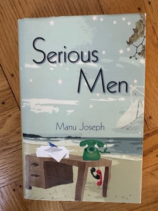

# Serious Men
**Author:** Manu Joseph | **Published:** 2010

---

## Summary

*Serious Men* is set at the fictional Institute of Theory and Research in Mumbai. Ayyan Mani, the personal assistant to the institute's director Arvind Acharya, lives with his wife and son in a one-room flat in the BDD chawls of Worli. Resentful of the Brahmin 'serious men' he serves, he invents a legend around his son Adi, feeding him complex facts and questions so that he appears to be a prodigy, and manipulates the press and school system to make the boy famous.

In parallel, Acharya, a celebrated astronomer pursuing a controversial project to find extraterrestrial microbes in the stratosphere, begins an affair with Oparna Goshmaulik, a young astronomer at the institute, which his rivals use to topple him. Ayyan's and Acharya's plots intersect with darkly comic results. The novel is told with sharp irony and sympathy for both men, and asks what intelligence and merit mean in a society shaped by caste.

---

## Critical Takeaways

- **Awards:** It won The Hindu Literary Prize in 2010 and the PEN/Open Book Award in 2011, and was widely praised as a striking debut.
- **Caste satire:** Critics highlight its unsentimental portrait of a Dalit protagonist who is neither victim nor saint, and its exposure of upper-caste self-regard in elite institutions.
- **Science and vanity:** The satire of academic science, funding politics and the cult of genius is often singled out as unusual in Indian fiction.
- **Tone:** Reviewers praised its wit and caustic humour, though some found the second half less tightly plotted and the female characters less developed.
- **Adaptation:** Sudhir Mishra's 2020 Netflix film starring Nawazuddin Siddiqui brought the story to a wider audience.

---

## My Takeaways

_To be written — Vishwas's personal takeaways._

---

## Footnotes

- [Wikipedia: Manu Joseph](https://en.wikipedia.org/wiki/Manu_Joseph)
- [Wikipedia: Serious Men (film)](https://en.wikipedia.org/wiki/Serious_Men_(film))
- [Goodreads](https://www.goodreads.com/search?q=Serious+Men+Manu+Joseph)
