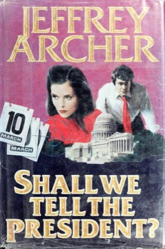

# Shall We Tell the President?
**Author:** Jeffrey Archer | **Published:** 1977

---

## Summary

Archer's second novel begins when the FBI learns of a conspiracy to assassinate the President on the steps of the Capitol, linked to a senator. Marc Andrews, a young FBI agent who stumbles onto the plot, is given a short time to identify which senator is involved and stop the attempt, while the FBI director decides to try to stop the plot without telling the President.

The story unfolds as a countdown, with Andrews working through a list of suspect senators, coping with killings among those who know about the plot, and pursuing a romance with a woman connected to one of the suspects.

The first edition set the story in an imagined near future with Edward Kennedy as President. In the revised 1980s edition the President became Florentyna Kane, the heroine of Archer's *The Prodigal Daughter*, removing a real politician from the plot.

---

## Critical Takeaways

- **Controversial premise:** Using a real, living politician (Edward Kennedy) as the target drew criticism as being in poor taste, especially given the Kennedy family's history.
- **Pacing:** Reviewers acknowledge Archer's ability to sustain suspense through a tight countdown structure.
- **Weak reviews:** Several critics at the time dismissed it as thin and clumsily written.
- **Revisions:** The later rewrite with Florentyna Kane is noted as a commercial and tonal adjustment.
- **Popular appeal:** Like Archer's other books, it sold strongly despite critical skepticism.

---

## My Takeaways

_To be written — Vishwas's personal takeaways._

---

## Footnotes

- [Wikipedia: Shall We Tell the President?](https://en.wikipedia.org/wiki/Shall_We_Tell_the_President%3F)
- [Goodreads](https://www.goodreads.com/search?q=Shall+We+Tell+the+President+Jeffrey+Archer)
