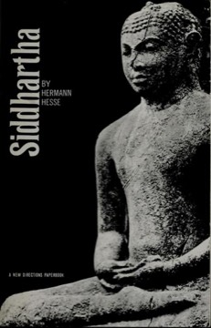

# Siddhartha
**Author:** Hermann Hesse | **Published:** 1922

---

## Summary

Siddhartha, the son of a Brahmin, leaves with his friend Govinda to join the wandering Samanas and practise austerity. They meet Gotama the Buddha; Govinda becomes a disciple, but Siddhartha, though he reveres the Buddha, concludes that enlightenment cannot be taught, only lived. In the city he learns love from the courtesan Kamala and business from the merchant Kamaswami, gradually sinking into greed, gambling and disgust. On the brink of suicide by a river he hears 'Om' and is reborn. He becomes the ferryman Vasudeva's companion, suffers the loss of the son he had with Kamala, and finally attains a sense of unity in which all things, past and future, are present in the river's many voices.

Hesse, whose grandparents were missionaries in India, wrote the novel after a 1911 journey to Asia and during a long creative crisis. It draws on Hindu and Buddhist ideas but insists that wisdom must be found by individual experience rather than doctrine.

---

## Critical Takeaways

- **Individual path:** Critics emphasise that the novel's central claim, that wisdom cannot be transmitted and must be lived, is as much a European individualist idea as an Indian one.
- **Lyrical simplicity:** Its spare, rhythmic prose and parable-like structure are widely praised and contribute to its enduring popularity.
- **Orientalism questions:** Scholars debate how faithfully it represents Buddhism and Hinduism; some see a respectful synthesis, others an idealised, Western projection.
- **Counterculture classic:** Its popularity surged in the 1960s, when it became a key text of American interest in Eastern spirituality.
- **Unity and the river:** The river as image of simultaneity and unity is regarded as the book's most powerful symbol.

---

## My Takeaways

_To be written — Vishwas's personal takeaways._

---

## Footnotes

- [Wikipedia — Siddhartha (novel)](https://en.wikipedia.org/wiki/Siddhartha_(novel))
- [Wikipedia — Hermann Hesse](https://en.wikipedia.org/wiki/Hermann_Hesse)
- [Goodreads — Siddhartha](https://www.goodreads.com/search?q=Siddhartha+Hermann+Hesse)
