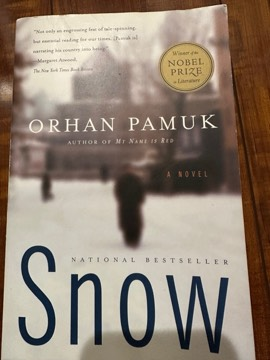

# Snow
**Author:** Orhan Pamuk | **Published:** 2002

---

## Summary

*Snow* (*Kar*, 2002; English translation by Maureen Freely, 2004) follows Ka, who arrives in Kars in eastern Turkey ostensibly as a journalist, but also hoping to win İpek, a woman he knew in university. A snowstorm cuts the city off, and during the few days of isolation Ka meets Islamist activists, a charismatic militant called Blue, secularist officials, Kurdish nationalists, and the 'headscarf girls' at the centre of the controversy. During a performance at the national theatre, an ageing actor stages a real military coup, and the city falls into violence.

Amid the chaos Ka, who had been unable to write for years, suddenly receives a series of poems that he later arranges according to the structure of a snowflake. The story is told after his death by a narrator named Orhan who retraces his steps, which turns the novel into a meditation on how stories about other people's lives are reconstructed. Pamuk refuses to give any side the last word, depicting the faithful and the secular with equal irony and sympathy.

---

## Critical Takeaways

- **Political novel:** Critics praised its depiction of the clash between Kemalist secularism and political Islam as unusually even-handed and prescient, particularly in the post-2001 context.
- **Ironic tone:** Reviewers note the book's mixture of farce and tragedy, with the theatrical coup as its signature absurdist set piece.
- **Metafiction:** The narrator Orhan's reconstruction of Ka's lost notebooks is read as Pamuk's characteristic play with authorship and identity.
- **Characterisation:** Some critics found Ka passive and the characters' long debates schematic, making the novel feel more like an argument than a story at points.
- **Recognition:** It was named one of the New York Times Book Review's ten best books of 2004 and is often cited as a major work in the body that earned Pamuk the 2006 Nobel Prize in Literature.

---

## My Takeaways

_To be written — Vishwas's personal takeaways._

---

## Footnotes

- [Wikipedia: Snow (Pamuk novel)](https://en.wikipedia.org/wiki/Snow_(Pamuk_novel))
- [Wikipedia: Orhan Pamuk](https://en.wikipedia.org/wiki/Orhan_Pamuk)
- [Goodreads](https://www.goodreads.com/search?q=Snow+Orhan+Pamuk)
