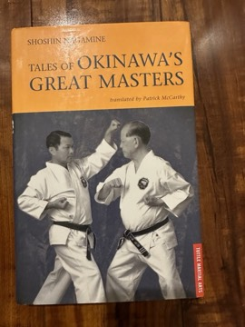

# Tales of Okinawa's Great Masters
**Author:** Shoshin Nagamine (translated by Patrick McCarthy) | **Published:** 2000

---

## Summary

Shoshin Nagamine (1907–1997), founder of Matsubayashi-ryu karate, was also a historian of Okinawan karate. *Tales of Okinawa's Great Masters* is Patrick McCarthy's English translation of Nagamine's collection of biographical stories about the major figures of the art's history, published by Tuttle.

The book profiles masters such as Sakugawa, Sokon Matsumura, Anko Itosu, Kanryo Higaonna, Choki Motobu and Chotoku Kyan (Nagamine's own teacher), among others. The chapters combine what is known of each man's life with anecdotes passed down in the Okinawan karate community: famous fights, training feats and sayings.

The tales also carry Nagamine's view of karate as a moral discipline, with frequent emphasis on character, humility and the avoidance of violence, and McCarthy adds historical notes and context for English readers.

---

## Critical Takeaways

- **Primary voice:** Critics value it as the perspective of a major twentieth-century Okinawan master on the generations before him, rather than a modern outsider's history.
- **Legend and history mixed:** Reviewers caution that many stories are oral tradition and hagiography, and should not be read as verified biography.
- **Translation and context:** McCarthy's translation and annotations are generally credited with making the material accessible, though some readers note the translator's own interpretive framing.
- **Moral emphasis:** The book is often read as much for its ethical teaching about karate-do as for its historical content.

---

## My Takeaways

_To be written — Vishwas's personal takeaways._

---

## Footnotes

- [Wikipedia — Shōshin Nagamine](https://en.wikipedia.org/wiki/Sh%C5%8Dshin_Nagamine)
- [Wikipedia — Matsubayashi-ryū](https://en.wikipedia.org/wiki/Matsubayashi-ry%C5%AB)
- [Goodreads — Tales of Okinawa's Great Masters](https://www.goodreads.com/search?q=Tales+of+Okinawa%27s+Great+Masters+Nagamine)
