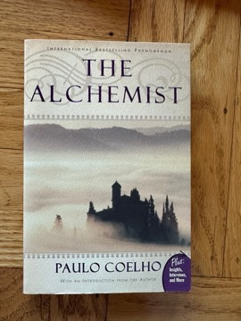

# The Alchemist
**Author:** Paulo Coelho | **Published:** 1988

---

## Summary

*The Alchemist* (*O Alquimista*), first published in Portuguese in 1988, follows Santiago, a young shepherd in Andalusia who has a recurring dream about treasure hidden near the pyramids. A mysterious king, Melchizedek, tells him to pursue his 'Personal Legend', and Santiago sells his flock, is robbed in Tangier, works for a crystal merchant, crosses the Sahara in a caravan, falls in love with Fatima at an oasis, and is guided by an alchemist who teaches him to read omens and listen to his heart and the 'Soul of the World'.

When Santiago finally reaches the pyramids, he learns that the treasure was buried back where his journey began, under a sycamore at a ruined church in Spain. The circular ending supports the book's message that the journey itself, and the courage to pursue one's dream, is what transforms a person. Its simple language and universal fable form drew on sources such as a tale from the *One Thousand and One Nights* and Borges's version of it.

---

## Critical Takeaways

- **Global phenomenon:** After a modest initial release in Brazil, it became one of the best-selling books in history and has been translated into more than 80 languages.
- **Fable form:** Admirers value its parable-like simplicity and spiritual optimism, comparing it to *The Little Prince* and *Jonathan Livingston Seagull*.
- **Literary criticism:** Many literary critics describe it as shallow, repetitive and self-help dressed as fiction, objecting especially to the idea that 'the universe conspires' to help those who want something.
- **Sources:** Commentators note that the core plot reworks an older folk tale found in the *One Thousand and One Nights* and retold by Borges.
- **Influence:** Whatever its literary standing, it is frequently cited by readers as life-changing and has had a large influence on popular spirituality and motivational culture.

---

## My Takeaways

_To be written — Vishwas's personal takeaways._

---

## Footnotes

- [Wikipedia: The Alchemist (novel)](https://en.wikipedia.org/wiki/The_Alchemist_(novel))
- [Wikipedia: Paulo Coelho](https://en.wikipedia.org/wiki/Paulo_Coelho)
- [Goodreads](https://www.goodreads.com/search?q=The+Alchemist+Paulo+Coelho)
