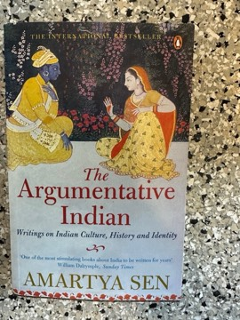

# The Argumentative Indian: Writings on Indian History, Culture and Identity
**Author:** Amartya Sen | **Published:** 2005

---

## Summary

In sixteen essays Sen argues that heterodoxy and argument are central to Indian civilisation. He points to dissent in the Vedas and Upanishads, the materialist Lokayata school, Buddhist and Jain traditions of reasoning, Ashoka's edicts on tolerance and Akbar's interfaith dialogues, and argues that this argumentative heritage is the root of modern India's secularism and democracy, rather than an import from the West.

The book also addresses contemporary questions: the dangers of Hindutva's narrow definition of identity, gender inequality and the 'missing women', poverty and public action, India's nuclear weapons, and relations with China. Throughout, Sen criticises both the Western tendency to see India as mystical and irrational and the nationalist tendency to reduce it to a single religious identity.

---

## Critical Takeaways

- **Plural identity:** Critics praised its defence of India as a plural, secular civilisation as a timely response to identity politics.
- **Selective history:** Some reviewers argued that Sen chose the evidence that fit his liberal thesis, foregrounding Ashoka and Akbar while giving less weight to hierarchy and orthodoxy.
- **Essay collection:** Because the essays were written separately, readers note repetition and uneven structure.
- **Public intellectual style:** It is seen as accessible and humane, combining Sen's economics, philosophy and cultural knowledge.
- **Political reception:** Hindu nationalist critics attacked it, while liberal commentators embraced it as a key statement of Indian secularism.

---

## My Takeaways

_To be written — Vishwas's personal takeaways._

---

## Footnotes

- [Wikipedia — The Argumentative Indian](https://en.wikipedia.org/wiki/The_Argumentative_Indian)
- [Wikipedia — Amartya Sen](https://en.wikipedia.org/wiki/Amartya_Sen)
- [Goodreads — The Argumentative Indian](https://www.goodreads.com/search?q=The+Argumentative+Indian+Amartya+Sen)
