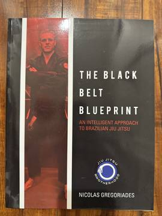

# The Black Belt Blueprint: An Intelligent Approach to Brazilian Jiu Jitsu
**Author:** Nicolas Gregoriades | **Published:** 2015

---

## Summary

Nicolas Gregoriades was Roger Gracie's first black belt, reaching that rank in roughly four years of intensive training. *The Black Belt Blueprint* sets out the approach behind that progress. Rather than a catalogue of techniques, it is a guide to *how* to learn Brazilian jiu-jitsu.

It covers the fundamentals and the main positions — mount, back mount, side control — with attention to body placement in attack and defence, then moves to the factors around the mat: training mindset, breathing, strength and conditioning, nutrition, overtraining and injury prevention, warm-ups, competition and even training in Brazil. Gregoriades writes as a member of the Jiu Jitsu Brotherhood, and the book mixes physical advice with a more reflective, philosophical view of practice.

---

## Critical Takeaways

- **Learning over technique:** Reviewers in the BJJ community value it for addressing how to progress, which most technique books ignore.
- **Enthusiastic reception:** BJJ Eastern Europe's reviewer gave it 10/10, calling it the book he wished he had read a dozen years earlier.
- **Intensity caveat:** The author trained up to three times a day; readers note that his timeline is not typical, though the principles apply to part-time players.
- **Holistic tone:** Its mix of physical, mental and spiritual advice appeals to some readers and feels loose to others who want concrete drills.

---

## My Takeaways

_To be written — Vishwas's personal takeaways._

---

## Footnotes

- [BJJ Eastern Europe review](https://www.bjjee.com/gear-review/the-black-belt-blueprint-or-how-nicolas-gregoriades-got-his-bjj-black-belt-in-4-years/)
- [Goodreads](https://www.goodreads.com/book/show/25629221)
