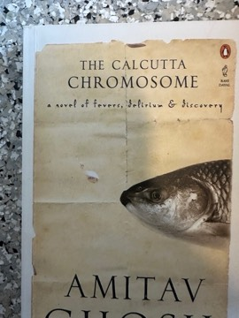

# The Calcutta Chromosome
**Author:** Amitav Ghosh | **Published:** 1995

---

## Summary

In a near-future New York, Antar, an Egyptian data clerk for a global health organisation, comes across the ID card of his missing colleague Murugan. Murugan had become obsessed with the idea that Ronald Ross's Nobel Prize-winning discovery of the malaria parasite's transmission by mosquitoes was secretly guided by others: a group of Indian servants and assistants, led by the enigmatic Mangala, who practised a counter-science based on silence and sought a 'Calcutta chromosome' allowing personalities to pass from body to body. The narrative moves between the 1890s and the 1990s and among Antar, Murugan and a cast of characters in Calcutta.

The novel mixes scientific history, mystery, ghost story and science fiction, and questions how colonial science claimed knowledge produced by colonised people who left no record.

---

## Critical Takeaways

- **Postcolonial science fiction:** Critics see it as a pioneering work that uses genre fiction to challenge the colonial history of science.
- **Silence as knowledge:** The idea of a counter-science that works by secrecy and refuses to be written is widely discussed as the book's central conceit.
- **Genre hybridity:** Its blend of thriller, history and ghost story is admired for ambition, though some reviewers found the plot convoluted and the ending elusive.
- **Recognition:** Its Arthur C. Clarke Award marked rare recognition for a South Asian novel within science fiction.
- **Historical grounding:** Its meticulous use of Ross's own memoirs gives the fantastical premise a strong documentary base.

---

## My Takeaways

_To be written — Vishwas's personal takeaways._

---

## Footnotes

- [Wikipedia — The Calcutta Chromosome](https://en.wikipedia.org/wiki/The_Calcutta_Chromosome)
- [Wikipedia — Amitav Ghosh](https://en.wikipedia.org/wiki/Amitav_Ghosh)
- [Goodreads — The Calcutta Chromosome](https://www.goodreads.com/search?q=The+Calcutta+Chromosome+Amitav+Ghosh)
