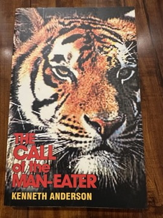

# The Call of the Man-Eater
**Author:** Kenneth Anderson | **Published:** 1961

---

## Summary

*The Call of the Man-Eater* gathers several accounts of Anderson's hunts for animals that had turned to killing people, set mainly in the forests and hill country of the old Mysore state and the districts around it, including areas of present-day Karnataka, Tamil Nadu and Andhra Pradesh. Alongside the tense pursuit of the animals, he describes night-long vigils, the tracking skills of local trackers and villagers, and the behaviour of wildlife.

As in his other books, Anderson writes with affection for the jungle and for the tribal and village people he hunted alongside, and he often reflects on why tigers and leopards become man-eaters, typically through wounds, age or human encroachment. The stories also offer a record of a landscape and way of life in mid-twentieth-century South India that has largely vanished.

---

## Critical Takeaways

- **Comparison with Corbett:** Critics and readers routinely compare Anderson with Jim Corbett; he is generally seen as a more colourful, sometimes more embellished storyteller, with a strong sense of the South Indian setting.
- **Regional value:** His books are valued as a record of the forests and communities of southern India before large-scale deforestation and wildlife protection laws.
- **Reliability:** Some commentators note that Anderson's narratives may dramatise or compress events, so they are best read as adventure literature rather than strict documentation.
- **Colonial-era perspective:** Modern readers note attitudes typical of the period in his depiction of local people, though he is also seen as unusually respectful of tribal knowledge.
- **Limited critical coverage:** Little formal literary criticism exists; his reputation rests on enduring popularity and reprints.

---

## My Takeaways

_To be written — Vishwas's personal takeaways._

---

## Footnotes

- [Wikipedia: Kenneth Anderson (writer)](https://en.wikipedia.org/wiki/Kenneth_Anderson_(writer))
- [Goodreads](https://www.goodreads.com/search?q=The+Call+of+the+Man-Eater+Kenneth+Anderson)
