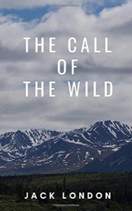

# The Call of the Wild
**Author:** Jack London | **Published:** 1903

---

## Summary

Buck lives comfortably on Judge Miller's estate in the Santa Clara Valley until a gardener sells him to dog traders feeding the Yukon Gold Rush's demand for sled dogs. Under 'the law of club and fang' he learns to survive: to fight, steal, sleep under snow and pull. He defeats the lead dog Spitz, passes through a series of masters, including an incompetent party who nearly work him to death, and is rescued by John Thornton, whom he loves with a devotion that keeps him tied to the human world. When Thornton is killed by Yeehat raiders, Buck takes revenge and joins a wolf pack, becoming a legendary 'Ghost Dog'.

London drew on his own year in the Klondike in 1897. Written in vivid, muscular prose, the book reflects the naturalism and Darwinian ideas of the era: environment and heredity shape character, and civilisation is a thin layer over older instincts.

---

## Critical Takeaways

- **Naturalism:** Critics place it within literary naturalism, emphasising survival of the fittest and the power of heredity and environment over individual will.
- **Atavism:** Buck's reversion to primal instinct is read both as a celebration of the wild and as an allegory of human desire to escape the constraints of modern industrial life.
- **Animal narrative:** It is praised for sustaining a dog's point of view without simple anthropomorphism, though some readers find Buck's 'racial memory' passages fanciful.
- **Gold Rush realism:** Its depiction of the cruelty of the Klondike trade and the treatment of animals is often singled out as unflinching.
- **Ideological undertones:** Later critics have examined the book's celebration of dominance and its echoes of period ideas about race and mastery.

---

## My Takeaways

_To be written — Vishwas's personal takeaways._

---

## Footnotes

- [Wikipedia — The Call of the Wild](https://en.wikipedia.org/wiki/The_Call_of_the_Wild)
- [Wikipedia — Jack London](https://en.wikipedia.org/wiki/Jack_London)
- [Goodreads — The Call of the Wild](https://www.goodreads.com/search?q=The+Call+of+the+Wild+Jack+London)
