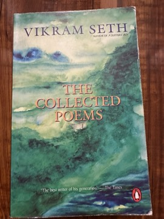

# The Collected Poems
**Author:** Vikram Seth | **Published:** 1995

---

## Summary

Seth began as a poet before he became famous as a novelist, and this volume (published in India by Penguin in the mid-1990s and associated with the British edition *The Poems 1981-1994*) collects that work. *The Humble Administrator's Garden* (1985) draws on his years as a student in China and his travels, with sections organised by place; *All You Who Sleep Tonight* (1990) contains short lyrics on love, solitude and grief, along with poems on historical suffering; and *Beastly Tales from Here and There* (1992) retells fables from India, China, Greece and elsewhere in jaunty rhymed verse.

Across the collections Seth favours traditional forms, rhyme and regular metre at a time when free verse dominated, and his tone ranges from wry and comic to quietly melancholy. The poems tend toward clarity rather than difficulty, and many are short enough to be memorised, which has made them popular with general readers as well as students of Indian writing in English.

---

## Critical Takeaways

- **Formalism:** Critics consistently note Seth's mastery of rhyme and metre, and regard him as one of the most technically accomplished formal poets writing in English in his generation.
- **Accessibility:** His clarity and humour are praised for making poetry approachable, while some critics feel the poems can be light or lacking in depth compared with more experimental contemporaries.
- **Range of settings:** The work moves between India, China, California and England, and is often discussed as an example of a cosmopolitan sensibility in Indian English poetry.
- **Recognition:** *The Humble Administrator's Garden* won the Commonwealth Poetry Prize (Asia region), and *Beastly Tales* has remained a popular children's and adult favourite.
- **Overshadowed by the novels:** Commentators often observe that his poetry receives less attention than *A Suitable Boy* and *The Golden Gate*, though the latter's verse form grows directly out of it.

---

## My Takeaways

_To be written — Vishwas's personal takeaways._

---

## Footnotes

- [Wikipedia: Vikram Seth](https://en.wikipedia.org/wiki/Vikram_Seth)
- [Goodreads](https://www.goodreads.com/search?q=Collected+Poems+Vikram+Seth)
