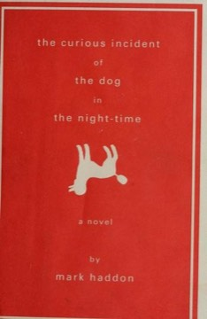

# The Curious Incident of the Dog in the Night-Time
**Author:** Mark Haddon | **Published:** 2003

---

## Summary

Christopher Boone finds his neighbor's poodle, Wellington, killed with a garden fork, and decides to investigate like Sherlock Holmes (the title comes from a Holmes story). Christopher loves prime numbers and logic, cannot tolerate being touched, and dislikes the colors yellow and brown; the chapters are numbered with primes and include diagrams and puzzles.

His investigation, written as a book for school, leads to revelations about his parents: his father has lied about his mother, and Christopher undertakes a terrifying journey alone to London to find her.

The novel was marketed to both adults and young readers, won the 2003 Whitbread Book of the Year, and was adapted by Simon Stephens into a National Theatre play that won Olivier and Tony awards.

---

## Critical Takeaways

- **Narrative voice:** Critics widely praised the convincing first-person voice, which lets readers experience the world as Christopher does.
- **Autism portrayal:** It was often described as a novel about a boy with Asperger's syndrome; some autistic readers and advocates criticized its portrayal as stereotyped, and Haddon later said he had not intended a diagnosis.
- **Family drama:** Reviewers note that beneath the mystery it is a moving story about a strained family.
- **Formal invention:** Its diagrams, maths problems and prime-numbered chapters are praised as integral to the character.
- **Crossover success:** It became a model of a crossover book appealing to both adult and young adult readers.

---

## My Takeaways

_To be written — Vishwas's personal takeaways._

---

## Footnotes

- [Wikipedia: The Curious Incident of the Dog in the Night-Time](https://en.wikipedia.org/wiki/The_Curious_Incident_of_the_Dog_in_the_Night-Time)
- [Goodreads](https://www.goodreads.com/search?q=The+Curious+Incident+of+the+Dog+in+the+Night-Time+Mark+Haddon)
