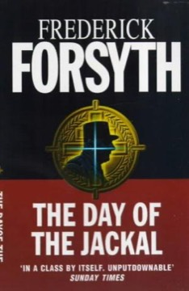

# The Day of the Jackal
**Author:** Frederick Forsyth | **Published:** 1971

---

## Summary

After failed attempts on de Gaulle's life, the OAS, the far-right group opposed to Algerian independence, hires a foreign professional unknown to French security. The Jackal meticulously prepares: forged identities, a custom-made dismountable rifle hidden in crutches, and a plan to shoot de Gaulle at the Liberation Day ceremony in Paris. When French intelligence learns of the plot, the investigation falls to Commissaire Claude Lebel, who traces the Jackal across Europe as the assassin adapts and kills to stay ahead. The climax brings both men to the same Paris square.

Forsyth, a former Reuters and BBC correspondent who had covered France, wrote the book in a few weeks. Its success rests on its documentary method: the reader knows de Gaulle survived, yet the novel builds suspense from the accumulation of detail about how such a plot could be carried out and stopped. Fred Zinnemann's 1973 film followed.

---

## Critical Takeaways

- **Procedural realism:** Critics credit it with establishing the documentary, research-heavy thriller, in which technical detail itself generates tension.
- **Suspense despite a known ending:** Its ability to grip readers who know de Gaulle was never assassinated is often cited as a feat of structure.
- **Spare characterisation:** The Jackal remains deliberately opaque; some reviewers see thin characterisation as the cost of the procedural focus.
- **Historical grounding:** Its use of real events, the OAS and the 1962 Petit-Clamart attack, gives it unusual credibility within the genre.
- **Influence:** It became a model for later thrillers and for real-world concerns about identity fraud, since its passport-forging method was later noted by investigators.

---

## My Takeaways

_To be written — Vishwas's personal takeaways._

---

## Footnotes

- [Wikipedia — The Day of the Jackal](https://en.wikipedia.org/wiki/The_Day_of_the_Jackal)
- [Wikipedia — Frederick Forsyth](https://en.wikipedia.org/wiki/Frederick_Forsyth)
- [Goodreads — The Day of the Jackal](https://www.goodreads.com/search?q=The+Day+of+the+Jackal+Frederick+Forsyth)
