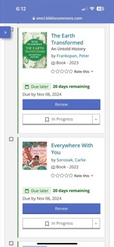

# The Earth Transformed: An Untold History
**Author:** Peter Frankopan | **Published:** 2023 | **Status:** partially read

---

## Summary

In *The Earth Transformed*, Peter Frankopan, author of *The Silk Roads*, attempts a global history of humanity with climate and the natural environment at the center. The book moves from the planet's deep past and the emergence of humans through the rise of agriculture and early civilizations to the modern era.

Across more than two dozen chapters, Frankopan draws on paleoclimate data, archaeology and historical sources to show how environmental factors (volcanic eruptions, shifting monsoons, droughts, the Little Ice Age, epidemics) influenced events such as the fall of empires, migrations and famines, and how human activity in turn transformed landscapes through deforestation, farming, colonization and industrialization.

The final chapters address anthropogenic climate change, presenting it as the latest and most dangerous chapter in a long story of human-environment interaction.

---

## Critical Takeaways

- **Ambitious synthesis:** Reviewers praised the book's enormous scope and the breadth of recent scientific research it brings together.
- **Global perspective:** As with *The Silk Roads*, critics noted the welcome attention to regions outside Europe.
- **Sprawling structure:** A common criticism was that the book is overwhelming and list-like, piling up examples without a clear central argument.
- **Causation caution:** Some historians cautioned that linking climate events to historical outcomes risks overstating environmental determinism.

---

## My Takeaways

_To be written — Vishwas's personal takeaways._

---

## Footnotes

- [Wikipedia — Peter Frankopan](https://en.wikipedia.org/wiki/Peter_Frankopan)
- [Goodreads — The Earth Transformed](https://www.goodreads.com/search?q=The+Earth+Transformed+Peter+Frankopan)
