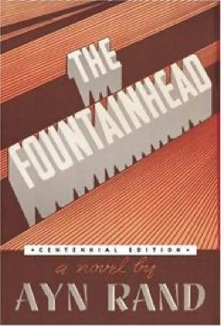

# The Fountainhead
**Author:** Ayn Rand | **Published:** 1943

---

## Summary

Howard Roark is expelled from architecture school for refusing to imitate historical styles. He struggles to work on his own terms while his former classmate Peter Keating, who builds his career by pleasing others and copying, rises rapidly. Around them are the newspaper publisher Gail Wynand, who has won power by giving the public what it wants; the critic Ellsworth Toohey, who seeks power by promoting mediocrity and collectivism; and Dominique Francon, who loves Roark but believes the world will destroy him.

The climax comes when Roark dynamites a housing project built from his design after others alter it, and in his trial he delivers a long speech defending the creator's right to his work and the primacy of the individual.

The novel was rejected by many publishers before Bobbs-Merrill took it. Sales grew through word of mouth, it was filmed in 1949 with Gary Cooper, and it established Rand's reputation before *Atlas Shrugged*.

---

## Critical Takeaways

- **Individualist manifesto:** Critics agree it is primarily a vehicle for Rand's ideas, which admirers find inspiring and detractors find simplistic.
- **Characterization:** Many critics see the characters as embodiments of ideas rather than people, with Roark especially schematic.
- **Sexual violence:** The scene in which Roark rapes Dominique is a long-standing point of criticism and debate.
- **Architecture:** Readers and critics have compared Roark with Frank Lloyd Wright, and the book shaped popular ideas of the heroic architect.
- **Lasting influence:** Despite mostly negative literary reviews, it has sold millions of copies and remains influential, particularly among young readers and libertarians.

---

## My Takeaways

_To be written — Vishwas's personal takeaways._

---

## Footnotes

- [Wikipedia: The Fountainhead](https://en.wikipedia.org/wiki/The_Fountainhead)
- [Goodreads](https://www.goodreads.com/search?q=The+Fountainhead+Ayn+Rand)
