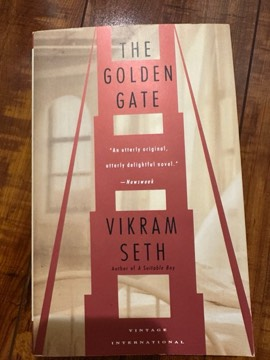

# The Golden Gate
**Author:** Vikram Seth | **Published:** 1986

---

## Summary

*The Golden Gate* begins with John Brown, a successful but lonely Silicon Valley engineer working in the defence industry, whose friend Janet Hayakawa, a sculptor and drummer, secretly places a personal ad on his behalf. It brings him Liz Dorati, a lawyer, and their romance draws in a wider circle: John's old friend Phil, a divorced father who has quit his defence job in protest; Liz's brother Ed, a devout Catholic struggling with his attraction to Phil; and Liz's family at their Sonoma vineyard. As relationships form and break, the friends become involved in a protest against nuclear weapons at a weapons laboratory, and the story moves toward loss and reconciliation.

The entire novel, including its dedication, acknowledgements and table of contents, is written in Onegin stanzas, fourteen lines of iambic tetrameter with a fixed rhyme scheme, a form Seth encountered through Charles Johnston's English translation of Pushkin. The verse lets him move between comedy, social satire of Bay Area life and moments of real grief, and it captures specific places, from the Golden Gate Bridge to Bay Area suburbs and wine country.

---

## Critical Takeaways

- **Formal virtuosity:** Critics were astonished that a debut novel in verse could be so readable; the sustained use of the Onegin stanza is the book's most celebrated feature.
- **Portrait of California:** Reviewers praised its sharp, affectionate picture of 1980s Bay Area culture, from yuppie loneliness and personal ads to Silicon Valley's ties to the defence industry, prompting Gore Vidal's 'Great California Novel' remark.
- **Emotional range:** The book is noted for moving from light comedy into genuine tragedy without losing its tone.
- **Politics and sexuality:** Its anti-nuclear theme and its sympathetic treatment of a gay relationship were noted as notable for a mainstream novel of its time.
- **Sceptics:** Some critics regarded the verse form as a brilliant stunt that occasionally forces rhymes and flattens character, though the consensus treats it as a lasting achievement.

---

## My Takeaways

_To be written — Vishwas's personal takeaways._

---

## Footnotes

- [Wikipedia: The Golden Gate (novel)](https://en.wikipedia.org/wiki/The_Golden_Gate_(novel))
- [Wikipedia: Vikram Seth](https://en.wikipedia.org/wiki/Vikram_Seth)
- [Goodreads](https://www.goodreads.com/search?q=The+Golden+Gate+Vikram+Seth)
