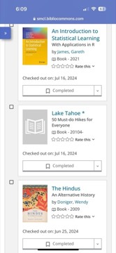

# The Hindus: An Alternative History
**Author:** Wendy Doniger | **Published:** 2009

---

## Summary

*The Hindus: An Alternative History* runs chronologically, from the Indus Valley civilisation through the Vedas, the epics, the Puranas and bhakti movements, to the Mughal and British periods and modern Hindu nationalism. Its 'alternative' angle is to read the tradition from below and from the margins: it asks what the texts reveal about women, Dalits, animals, and those who disputed or satirised the dominant Brahmanical view, and it emphasises the way Hinduism absorbed and argued with other traditions, including Buddhism, Jainism and Islam.

Doniger, a Sanskritist and historian of religions at the University of Chicago, writes in a personal, often playful voice and draws heavily on mythology, which she reads with an eye to sexuality, power and contradiction. The book's reputation is inseparable from its controversy: in 2014, after a lawsuit by the Shiksha Bachao Andolan led by Dinanath Batra alleging that it hurt religious sentiments, Penguin India agreed to withdraw and pulp its remaining copies, prompting a wide debate about Indian laws on religious offence and publishers' willingness to defend books.

---

## Critical Takeaways

- **Pluralistic history:** Many reviewers praised its erudition and its insistence on Hinduism's diversity, finding the focus on marginal voices a genuine corrective to sanitised accounts.
- **Critical recognition:** It was a finalist for the 2009 National Book Critics Circle Award for nonfiction.
- **Scholarly objections:** Some scholars and reviewers pointed to factual errors, overstatement, and an over-reliance on mythological texts and psychoanalytic interpretation as evidence of social history.
- **Tone:** Doniger's irreverent, punning style delighted some readers and offended others, who felt it trivialised sacred material.
- **Censorship controversy:** The 2014 withdrawal by Penguin India became an international free-speech cause; the book was subsequently reissued by another Indian publisher, and the episode is now a standard case in discussions of Section 295A of the Indian Penal Code.

---

## My Takeaways

_To be written — Vishwas's personal takeaways._

---

## Footnotes

- [Wikipedia: The Hindus: An Alternative History](https://en.wikipedia.org/wiki/The_Hindus:_An_Alternative_History)
- [Wikipedia: Wendy Doniger](https://en.wikipedia.org/wiki/Wendy_Doniger)
- [Goodreads](https://www.goodreads.com/search?q=The+Hindus+An+Alternative+History+Wendy+Doniger)
