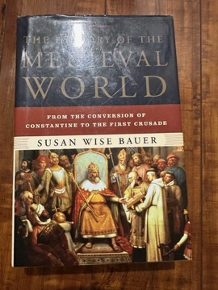

# The History of the Medieval World: From the Conversion of Constantine to the First Crusade
**Author:** Susan Wise Bauer | **Published:** 2010

---

## Summary

*The History of the Medieval World* (W. W. Norton, 2010) continues Bauer's *The History of the Ancient World*. It opens with Constantine's adoption of Christianity and ends with the First Crusade, arranged in roughly chronological chapters that jump between regions: the fragmenting Western Roman Empire and the rise of the Franks, the Byzantine Empire, the Sassanid Persians, the rise and expansion of Islam, the Gupta and later Indian kingdoms, the Sui, Tang and Song dynasties in China, and the emergence of states in Korea and Japan. Each chapter is anchored in rulers, wars and successions, with maps and timelines.

Bauer's recurring theme is how rulers used religion, whether Christianity, Islam or Buddhism, to legitimise and consolidate power, and how universal faiths and political ambition shaped each other across Eurasia. The approach is deliberately narrative: it tells stories of kings, usurpers and conquests rather than offering social, economic or historiographical analysis.

---

## Critical Takeaways

- **Global scope:** Reviewers credit Bauer for genuinely placing Asia and the Islamic world alongside Europe, which few single-author popular histories attempt.
- **Readability:** Its brisk storytelling and short chapters are widely praised, and the series is especially popular in the homeschooling community, where Bauer is well known for *The Well-Trained Mind*.
- **Secondary sources:** Academic critics note that it is a synthesis built largely on secondary literature, occasionally repeating outdated interpretations and offering little engagement with historiographical debate.
- **Political narrative:** Some reviewers find the focus on rulers and battles makes the book a sequence of successions that can feel episodic and thin on daily life, economy and culture.
- **Reference value:** Even critics acknowledge its usefulness as an orienting overview that lets readers see what was happening simultaneously across regions.

---

## My Takeaways

_To be written — Vishwas's personal takeaways._

---

## Footnotes

- [Wikipedia: Susan Wise Bauer](https://en.wikipedia.org/wiki/Susan_Wise_Bauer)
- [Goodreads](https://www.goodreads.com/search?q=History+of+the+Medieval+World+Susan+Wise+Bauer)
