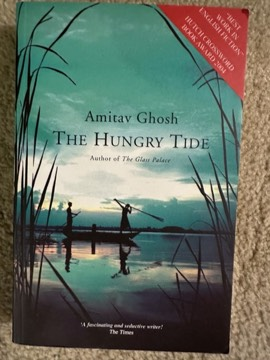

# The Hungry Tide
**Author:** Amitav Ghosh | **Published:** 2004

---

## Summary

Piya Roy, a marine biologist raised in America, arrives in the Sundarbans to study the rare Irrawaddy river dolphin. She meets Kanai Dutt, a translator and businessman visiting his aunt Nilima, who runs a hospital on the island of Lusibari, and Fokir, a fisherman who knows the waters intimately but cannot read. Kanai's late uncle Nirmal has left a notebook describing the events of 1979 on the island of Marichjhapi, where refugees from Bangladesh settled and were forcibly evicted by the state in the name of tiger conservation. The novel's climax is a cyclone that tests every relationship.

Ghosh uses the shifting landscape, where tides remake islands daily, to explore questions of belonging, language and translation, the claims of animals and people, and the local legend of Bon Bibi, the forest goddess.

---

## Critical Takeaways

- **Environmental justice:** Critics highlight its critique of conservation that excludes the poor, notably through the Marichjhapi episode.
- **Landscape as character:** Its rendering of the Sundarbans' tides, mangroves and storms is widely praised.
- **Translation and communication:** The relations between Piya, Kanai and Fokir, who share no common language, are read as a meditation on understanding across class and culture.
- **Didactic tendencies:** Some reviewers found the explanatory passages on science and history heavy.
- **Climate-fiction precursor:** It is often cited in discussions of Ghosh's later nonfiction *The Great Derangement* and of literature's engagement with climate.

---

## My Takeaways

_To be written — Vishwas's personal takeaways._

---

## Footnotes

- [Wikipedia — The Hungry Tide](https://en.wikipedia.org/wiki/The_Hungry_Tide)
- [Wikipedia — Amitav Ghosh](https://en.wikipedia.org/wiki/Amitav_Ghosh)
- [Goodreads — The Hungry Tide](https://www.goodreads.com/search?q=The+Hungry+Tide+Amitav+Ghosh)
