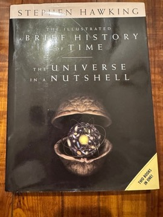

# The Illustrated A Brief History of Time / The Universe in a Nutshell
**Author:** Stephen Hawking | **Status:** partially read

---

## Summary

*A Brief History of Time* (1988) is Stephen Hawking's account for general readers of modern cosmology and physics: the history of ideas about space and time, the expanding universe and the Big Bang, the uncertainty principle, elementary particles, black holes and Hawking radiation, the arrow of time, and the quest to unify general relativity and quantum mechanics. It became one of the best-selling science books ever. The 1996 illustrated edition revised and expanded the text and added extensive color illustrations to make its concepts easier to visualize.

*The Universe in a Nutshell* (2001) was written as a sequel, in a heavily illustrated format from the start. It is organized more loosely, with chapters that can be read independently, and covers developments since the earlier book: supergravity, string theory and M-theory, branes, time travel, imaginary time and the no-boundary proposal, and speculation about the future of humanity and technology.

Together the two books represent Hawking's best-known efforts to bring theoretical physics to a mass readership.

---

## Critical Takeaways

- **Phenomenal popularity:** *A Brief History of Time* spent years on bestseller lists and is credited with creating a market for popular physics.
- **Unread bestseller:** It was famously described as one of the most bought and least finished books, with critics noting that its later chapters are hard going for lay readers.
- **Illustrations help:** Reviewers felt the illustrated formats made the abstract material substantially more approachable.
- **Sequel reception:** *The Universe in a Nutshell* won the Aventis Prize for Science Books in 2002, though some critics found its treatment of string and M-theory more speculative and less coherent than the original.

---

## My Takeaways

_To be written — Vishwas's personal takeaways._

---

## Footnotes

- [Wikipedia — A Brief History of Time](https://en.wikipedia.org/wiki/A_Brief_History_of_Time)
- [Wikipedia — The Universe in a Nutshell](https://en.wikipedia.org/wiki/The_Universe_in_a_Nutshell)
- [Goodreads — The Illustrated A Brief History of Time](https://www.goodreads.com/search?q=Illustrated+Brief+History+of+Time+Hawking)
