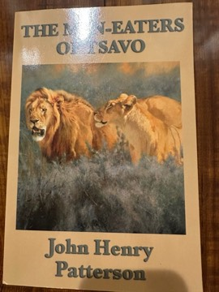

# The Man-Eaters of Tsavo
**Author:** John Henry Patterson | **Published:** 1907

---

## Summary

Patterson, a British army engineer, arrived at Tsavo in 1898 to oversee construction of a bridge for the Uganda Railway, which was being built largely by indentured labourers from India. Over the following months two lions repeatedly dragged men from their tents at night, causing panic, mass desertions and a halt to construction. Patterson describes his many failed attempts to trap and shoot them, building bomas and traps and sitting up in trees, until he finally killed both animals in December 1898.

The second half of the book covers other episodes of railway building, hunting and exploration in the region, including encounters with local peoples and wildlife. Patterson claimed the lions killed around 135 people; the skins and skulls he sold to the Field Museum in Chicago in 1924 have since been studied by scientists, and a 2009 chemical analysis of the remains suggested a substantially lower number of human victims.

---

## Critical Takeaways

- **Adventure classic:** The book has remained in print for over a century and is regarded as a foundational work of the man-eater genre.
- **Death toll debate:** Researchers have questioned Patterson's figure of 135 victims; isotope analysis published in 2009 estimated around 35 people eaten by the two lions, though other deaths may not have been captured by the method.
- **Colonial perspective:** Modern readers note the book's attitudes toward Indian and African workers and its framing of empire-building as heroic enterprise.
- **Scientific interest:** The lions' manelessness and the reasons for their man-eating, possibly including dental problems and disrupted prey populations, have been studied by zoologists at the Field Museum.
- **Adaptations:** The story inspired the 1952 film *Bwana Devil* and the 1996 film *The Ghost and the Darkness*.

---

## My Takeaways

_To be written — Vishwas's personal takeaways._

---

## Footnotes

- [Wikipedia: The Man-Eaters of Tsavo](https://en.wikipedia.org/wiki/The_Man-Eaters_of_Tsavo)
- [Wikipedia: Tsavo Man-Eaters](https://en.wikipedia.org/wiki/Tsavo_Man-Eaters)
- [Goodreads](https://www.goodreads.com/search?q=The+Man-Eaters+of+Tsavo+Patterson)
