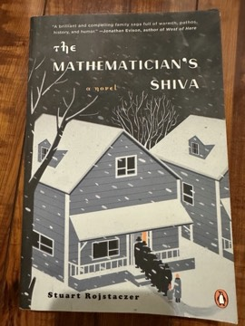

# The Mathematician's Shiva
**Author:** Stuart Rojstaczer | **Published:** 2014

---

## Summary

Alexander 'Sasha' Karnokovitch, a professor of atmospheric science, narrates the week of mourning after the death of his mother, Rachela, a celebrated mathematician who emigrated from Poland via the Soviet Union and taught for decades at the University of Wisconsin. Rumours that she had solved one of the great open problems in mathematics, the existence and smoothness of solutions to the Navier-Stokes equations, a Millennium Prize problem with a million-dollar prize, bring a crowd of eccentric mathematicians to the house. They search the papers, argue, eat, and try to outlast one another, turning a Jewish mourning ritual into a farce.

Interleaved with the comedy are excerpts from Rachela's memoir of her harsh childhood, wartime survival and early mathematical career in the Soviet Union, which give the novel its emotional weight. The book explores the relationship between a demanding genius and her son, the immigrant Jewish experience, and the strange social world of mathematicians.

---

## Critical Takeaways

- **Comic tone:** Reviewers enjoyed its warm, gently satirical humour and comparisons were made to classic Jewish-American comic fiction.
- **Mathematics culture:** Readers with academic backgrounds praise its affectionate, recognisable portrait of mathematicians' obsessions and rivalries, though the mathematics itself stays in the background.
- **Rachela's backstory:** The memoir sections set in Poland and the Soviet Union are often singled out as the most powerful parts of the book.
- **Structure:** Some critics found the large cast and episodic shiva scenes repetitive or meandering in the middle.
- **Debut novel:** It was generally received as a promising and charming first novel by an author coming from a scientific career.

---

## My Takeaways

_To be written — Vishwas's personal takeaways._

---

## Footnotes

- [Goodreads](https://www.goodreads.com/search?q=The+Mathematician%27s+Shiva+Stuart+Rojstaczer)
- [Wikipedia: Navier-Stokes existence and smoothness](https://en.wikipedia.org/wiki/Navier%E2%80%93Stokes_existence_and_smoothness)
