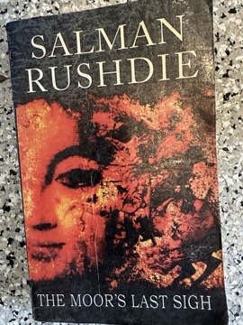

# The Moor's Last Sigh
**Author:** Salman Rushdie | **Published:** 1995 | **Status:** partially read

---

## Summary

*The Moor's Last Sigh* is narrated by Moraes Zogoiby, nicknamed "Moor", who has a deformed hand and a condition that makes him age twice as fast as normal. He tells the history of his family: the da Gama spice merchants of Cochin, descended in legend from Vasco da Gama, and his father Abraham Zogoiby, a Jewish clerk who becomes a Bombay business tycoon and, secretly, a criminal kingpin.

At the heart of the novel is Moor's mother, Aurora Zogoiby, a celebrated painter whose canvases reimagine Moor as a figure from Moorish Spain, linking India's syncretic culture with the multicultural Andalusia that ended with the fall of Granada in 1492 (the "Moor's last sigh" of Boabdil). Expelled by his mother, Moor falls in with Raman Fielding, leader of a Hindu nationalist party clearly modeled on Bal Thackeray and the Shiv Sena, before the story ends in Spain.

The novel mourns the loss of a tolerant, hybrid India and satirizes communal politics and the Bombay of the early 1990s.

---

## Critical Takeaways

- **Awards:** It won the Whitbread Novel Award in 1995 and was shortlisted for the Booker Prize.
- **Elegy for pluralism:** Critics read it as Rushdie's lament for a secular, cosmopolitan India threatened by religious nationalism.
- **Political controversy:** Its thinly veiled satire of Bal Thackeray and the Shiv Sena made it controversial in India on publication.
- **Style:** Reviewers praised its exuberance and wordplay, though some found it overstuffed and less controlled than *Midnight's Children*.
- **Art as theme:** Aurora's paintings are seen as a key device through which the novel reflects on art's role in imagining national identity.

---

## My Takeaways

_To be written — Vishwas's personal takeaways._

---

## Footnotes

- [Wikipedia — The Moor's Last Sigh](https://en.wikipedia.org/wiki/The_Moor%27s_Last_Sigh)
- [Wikipedia — Salman Rushdie](https://en.wikipedia.org/wiki/Salman_Rushdie)
- [Goodreads — The Moor's Last Sigh](https://www.goodreads.com/search?q=The+Moor%27s+Last+Sigh+Rushdie)
