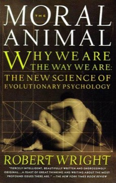

# The Moral Animal: Why We Are the Way We Are: The New Science of Evolutionary Psychology
**Author:** Robert Wright | **Published:** 1994

---

## Summary

Robert Wright, a journalist and author, sets out the then-new field of evolutionary psychology for general readers. He explains how ideas such as kin selection, reciprocal altruism, parental investment and sexual selection can account for recurring human patterns: differences in male and female mating strategies, the love and conflicts within families, the dynamics of friendship and social status, and the emotions behind moral judgment.

The book is structured around Darwin's biography: his courtship and marriage, his family life, his career ambitions and his delay in publishing his theory become examples of the evolutionary forces Wright describes. This makes abstract theory concrete and ties it back to its founder.

Wright closes by considering what the science implies for ethics. He argues that understanding the selfish roots of moral feelings need not lead to cynicism and can support a more self-aware, even more compassionate, morality.

---

## Critical Takeaways

- **Accessible synthesis:** Reviewers praised it as one of the clearest popular introductions to evolutionary psychology.
- **Darwin as frame:** The biographical device is widely considered effective and original.
- **Adaptationist overreach:** Critics, especially from biology and the social sciences, argue that many explanations in the field are speculative "just-so stories" that are hard to test.
- **Gender claims:** Its account of male and female mating psychology has been challenged as overstated and as reflecting cultural assumptions.
- **Moral implications:** Its discussion of how moral sentiments evolved is seen as thought-provoking, though philosophers question the leap from evolutionary origins to ethical conclusions.

---

## My Takeaways

_To be written — Vishwas's personal takeaways._

---

## Footnotes

- [Wikipedia: The Moral Animal](https://en.wikipedia.org/wiki/The_Moral_Animal)
- [Goodreads](https://www.goodreads.com/search?q=The+Moral+Animal+Robert+Wright)
