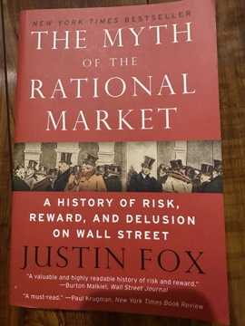

# The Myth of the Rational Market: A History of Risk, Reward, and Delusion on Wall Street
**Author:** Justin Fox | **Published:** 2009

---

## Summary

Justin Fox, a business journalist, tells the story of the idea that financial markets are rational and efficient. The book begins with figures such as Irving Fisher and the early statisticians of market prices, and moves through the work of Harry Markowitz on portfolio theory, Paul Samuelson and Eugene Fama on random walks and efficient markets, and Fischer Black, Myron Scholes and Robert Merton on options pricing.

Fox shows how these ideas left the academy and reshaped Wall Street through index funds, risk models, derivatives and the shareholder-value approach to corporate management. He then follows the critics, from Benoit Mandelbrot's work on fat tails to Robert Shiller's work on excess volatility and the behavioral economists Daniel Kahneman, Amos Tversky and Richard Thaler.

Published in 2009, the book reads the financial crisis as, in part, the consequence of over-trusting models that assumed markets would price risk correctly, while also acknowledging what the efficient-markets tradition got right.

---

## Critical Takeaways

- **Accessible intellectual history:** Reviewers praised Fox for making the development of financial economics readable through biography and narrative.
- **Timeliness:** Its appearance after the 2008 crash gave it wide attention as an explanation of the ideas behind the crisis.
- **Balanced tone:** Critics noted that despite the title, Fox treats efficient-market theorists fairly and does not claim markets are simply irrational.
- **Limited prescriptions:** Some reviewers felt the book is stronger on history than on what should replace the rational-market paradigm.

---

## My Takeaways

_To be written — Vishwas's personal takeaways._

---

## Footnotes

- [Wikipedia — Efficient-market hypothesis](https://en.wikipedia.org/wiki/Efficient-market_hypothesis)
- [Goodreads — The Myth of the Rational Market](https://www.goodreads.com/search?q=The+Myth+of+the+Rational+Market+Justin+Fox)
