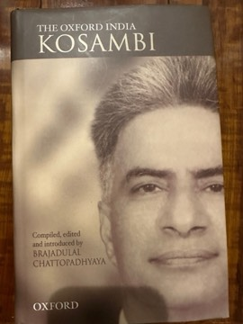
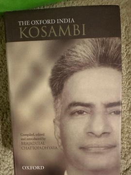

# The Oxford India Kosambi: Combined Methods in Indology and Other Writings
**Author:** D. D. Kosambi (compiled and edited by Brajadulal Chattopadhyaya) | **Published:** 2002 | **Status:** partially read

 

---

## Summary

*The Oxford India Kosambi* collects a wide range of D. D. Kosambi's essays, drawn from journals and earlier books, into a single volume. Kosambi trained as a mathematician and held research posts in mathematics, but he is best remembered for redirecting the study of early Indian history away from dynasties and kings toward modes of production, tribe-to-caste transitions, trade, and the material conditions behind religious and literary texts.

The anthology's title phrase, "combined methods," reflects Kosambi's insistence that Indology needed more than philology: he paired textual work with field observation of living village practice, archaeology, and the statistical study of punch-marked coins. Brajadulal Chattopadhyaya, himself a historian of early India, organizes the material thematically and supplies an introduction situating Kosambi in Indian historiography.

The volume is valuable both as a record of Kosambi's thought and as a reminder of how much of the later social history of ancient India (by historians such as R. S. Sharma and Romila Thapar) builds on questions he first posed.

---

## Critical Takeaways

- **Founding figure:** Historians widely credit Kosambi with founding the materialist approach to ancient Indian history, shifting attention from rulers to production, society and economy.
- **Interdisciplinary method:** Reviewers highlight the breadth of his toolkit (philology, numismatics, statistics, fieldwork), which remains unusual in Indian historiography.
- **Dated in places:** Critics note that some of Kosambi's specific claims and his Marxist framework have been revised or challenged by later archaeology and scholarship.
- **Useful anthology:** Chattopadhyaya's selection is praised for making scattered and hard-to-find essays accessible in one place, though any selection inevitably leaves material out.
- **Polemical style:** Kosambi's sharp, combative prose is part of his appeal for admirers and a point of objection for those who see it as dismissive of traditional scholarship.

---

## My Takeaways

_To be written — Vishwas's personal takeaways._

---

## Footnotes

- [Wikipedia: D. D. Kosambi](https://en.wikipedia.org/wiki/D._D._Kosambi)
- [Goodreads](https://www.goodreads.com/search?q=The+Oxford+India+Kosambi+Chattopadhyaya)
