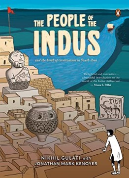

# The People of the Indus
**Author:** Nikhil Gulati and Jonathan Mark Kenoyer | **Published:** 2016

---

## Summary

*The People of the Indus* uses the comics form to introduce readers to the Bronze Age Indus civilisation of present-day Pakistan and north-western India. It covers how the civilisation was discovered, what excavations at sites such as Harappa and Mohenjo-daro have revealed about planned cities, drainage, standardised weights, seals and beadmaking, and how the Indus people traded with distant regions, while being careful about what remains unknown, such as the undeciphered script.

Kenoyer, a professor at the University of Wisconsin-Madison and long-time co-director of excavations at Harappa, provided the archaeological basis, and Gulati, a comics artist, translated the material into visual storytelling. The book is aimed at general readers and younger audiences.

---

## Critical Takeaways

- **Expert grounding:** Its main distinction noted by reviewers is that it is backed by a leading Indus archaeologist rather than relying on speculation.
- **Accessible format:** The graphic form is seen as an effective way to make an often dry archaeological subject engaging for students and general readers.
- **Caution about the unknown:** Kenoyer's influence shows in its restraint about contested questions such as the script and the civilisation's decline.
- **Limited critical coverage:** Little published criticism exists beyond brief notices in Indian media and reader reviews.

---

## My Takeaways

_To be written — Vishwas's personal takeaways._

---

## Footnotes

- [Wikipedia: Jonathan Mark Kenoyer](https://en.wikipedia.org/wiki/Jonathan_Mark_Kenoyer)
- [Wikipedia: Indus Valley Civilisation](https://en.wikipedia.org/wiki/Indus_Valley_Civilisation)
- [Goodreads](https://www.goodreads.com/search?q=The+People+of+the+Indus+Nikhil+Gulati)
