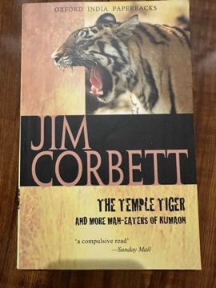

# The Temple Tiger and More Man-Eaters of Kumaon
**Author:** Jim Corbett | **Published:** 1954

---

## Summary

*The Temple Tiger and More Man-Eaters of Kumaon* (Oxford University Press, 1954) collects several hunting narratives, including the title story and accounts of man-eaters in the Kumaon region such as those of Muktesar, Panar, Chuka and Talla Des. As in his earlier book, Corbett describes the long process of tracking, waiting and reading the jungle, the fear in affected villages, and the physical hardship of hunting in steep, forested hill country.

The title story, in which a tiger appears to be protected by a temple's deity, reflects Corbett's interest in the beliefs and folklore of the hill people, which he reports with respect rather than ridicule. The book also includes his reflections on his own age and the toll of years of such work.

---

## Critical Takeaways

- **Companion volume:** Reviewers see it as continuing the strengths of *Man-Eaters of Kumaon*: understated prose, suspense and a naturalist's eye.
- **Talla Des story:** The account of the Talla Des man-eater, hunted while Corbett was suffering from a serious ear injury, is often singled out as one of his most harrowing narratives.
- **Folklore and belief:** The title story is noted for its respectful treatment of local religious belief and the limits of the hunter's control.
- **Less famous:** It has never matched the fame of the first collection, and some readers find the later stories less tightly shaped.
- **Historical record:** Like Corbett's other books, it is valued as a record of Kumaon village life in the early twentieth century.

---

## My Takeaways

_To be written — Vishwas's personal takeaways._

---

## Footnotes

- [Wikipedia: Jim Corbett](https://en.wikipedia.org/wiki/Jim_Corbett)
- [Goodreads](https://www.goodreads.com/search?q=The+Temple+Tiger+Jim+Corbett)
