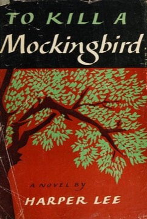

# To Kill a Mockingbird
**Author:** Harper Lee | **Published:** 1960

---

## Summary

In the small town of Maycomb, Scout, her brother Jem and their friend Dill spend summers obsessed with their reclusive neighbour Boo Radley. Their father Atticus agrees to defend Tom Robinson, accused by Mayella Ewell and her father Bob. Atticus demonstrates in court that Tom could not have committed the crime, but the all-white jury convicts him anyway, and Tom is later shot trying to escape. Bob Ewell, humiliated, attacks the children on Halloween night; they are saved by Boo Radley, who kills Ewell, and the sheriff decides to protect Boo by reporting that Ewell fell on his knife.

The novel combines a coming-of-age story with a courtroom drama and is told by an adult Scout looking back on childhood. Its moral lessons, that one should understand others by 'climbing into their skin', and that it is a sin to kill a mockingbird, became part of American culture, reinforced by the 1962 film with Gregory Peck.

---

## Critical Takeaways

- **Moral education:** Critics see it as a powerful story of conscience and empathy, which explains its long place in school curricula.
- **White saviour critique:** Later critics argue that it centres a white hero and gives Tom Robinson and other Black characters little interiority.
- **Child's-eye narration:** Scout's perspective lends humour and immediacy, though some find the retrospective adult voice uneven.
- **Gothic and regional texture:** Its portrait of small-town Southern life, class distinctions and the Boo Radley subplot are praised as its literary richness.
- **Reassessment after Go Set a Watchman:** The 2015 publication of Lee's earlier draft, with a segregationist Atticus, prompted renewed debate about the novel's idealised hero.

---

## My Takeaways

_To be written — Vishwas's personal takeaways._

---

## Footnotes

- [Wikipedia — To Kill a Mockingbird](https://en.wikipedia.org/wiki/To_Kill_a_Mockingbird)
- [Wikipedia — Harper Lee](https://en.wikipedia.org/wiki/Harper_Lee)
- [Goodreads — To Kill a Mockingbird](https://www.goodreads.com/search?q=To+Kill+a+Mockingbird+Harper+Lee)
