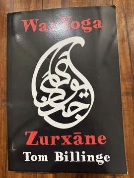

# WarYoga: Zurxāne
**Author:** Tom Billinge | **Published:** 2023

---

## Summary

*WarYoga: Zurxāne* extends Tom Billinge's WarYoga project, which began with Indian wrestling (kushti) conditioning and Tantric ideas and presents them as surviving fragments of an old Indo-European system of physical and spiritual training. This volume turns to Iran. Billinge, a Western practitioner who trained inside the modern zurxāne system, describes the 'House of Strength': the sunken pit, the drummer-singer (morshed), the heavy Indian-club-like *meels*, the wooden shield, the spinning and the wrestling, all performed as a ritual as much as a workout.

The book frames the zurxāne through the strongly dualistic outlook of Iranian religion, in which a cosmic struggle between light and darkness sets the moral terms of life. Training, in this reading, is an outward enactment of an inner fight against a lower, Ahrimanic impulse, and the zurxāne becomes a sibling of the Indian akhara: two branches of a shared heritage that have taken different shapes. Practical description of the exercises sits alongside history, mythology and the author's own experience of the tradition.

---

## Critical Takeaways

- **Niche, practitioner-written:** This is a small-press book by a practitioner rather than an academic study; little published criticism exists, and its readership is mainly people interested in traditional strength training.
- **Comparative thesis:** The book's central move, treating the Iranian zurxāne and the Indian akhara as related expressions of an Indo-European inheritance, is suggestive but goes beyond what most historians of the zurxāne would assert; scholarly accounts tend to stress its Islamic-era, Sufi-inflected and nationalist development.
- **Access to a closed world:** Its value lies in describing from the inside a tradition that has very little English-language coverage, with UNESCO's recognition of the pahlevani and zoorkhanei rituals as intangible heritage pointing to its cultural importance.
- **Blending of registers:** Exercise instruction, religious history and spiritual interpretation are mixed freely, which readers seeking either a pure training manual or a rigorous history may find uneven.

---

## My Takeaways

_To be written — Vishwas's personal takeaways._

---

## Footnotes

- [Goodreads — WarYoga: Zurxane](https://www.goodreads.com/search?q=WarYoga+Zurxane+Tom+Billinge)
- [Wikipedia — Zurkhaneh](https://en.wikipedia.org/wiki/Zurkhaneh)
- [Revgear blog — War Yoga, Tom Billinge](https://blog.revgear.com/war-yoga-tom-billinge/)
