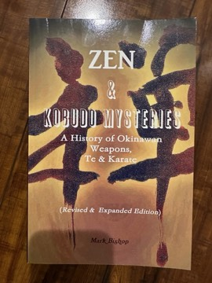

# Zen & Kobudo Mysteries: A History of Okinawan Weapons, Te & Karate
**Author:** Mark Bishop | **Published:** 1996

---

## Summary

*Zen & Kobudo Mysteries* is the revised edition of Mark Bishop's *Zen Kobudo: Mysteries of Okinawan Weaponry and Te*, originally published by Tuttle in the 1990s. It turns from the karate styles covered in his *Okinawan Karate* to Okinawa's weapon traditions and to te, the indigenous fighting art that preceded and fed into karate.

The book covers the history and lineages of kobudo, including the systems associated with Taira Shinken and the Matayoshi family, and describes the main weapons: bo, sai, tonfa, nunchaku, kama, eku and others. It also discusses lesser-known and secretive arts and teachers, as well as the role of Zen and other philosophical ideas in Okinawan martial culture.

As with Bishop's other work, it draws heavily on his time training in Okinawa and on interviews with teachers there.

---

## Critical Takeaways

- **Rare subject coverage:** Reviewers note it is one of relatively few English-language books focusing on the history and lineages of Okinawan kobudo.
- **First-hand basis:** Its reliance on Bishop's direct contact with Okinawan teachers is seen as a strength.
- **Speculative passages:** Some readers find the treatment of secret arts and philosophy more anecdotal than documented.
- **Limited critical coverage:** Little published criticism exists outside martial-arts readership.

---

## My Takeaways

_To be written — Vishwas's personal takeaways._

---

## Footnotes

- [Wikipedia — Okinawan kobudō](https://en.wikipedia.org/wiki/Okinawan_kobud%C5%8D)
- [Goodreads — Zen Kobudo](https://www.goodreads.com/search?q=Zen+Kobudo+Mark+Bishop)
