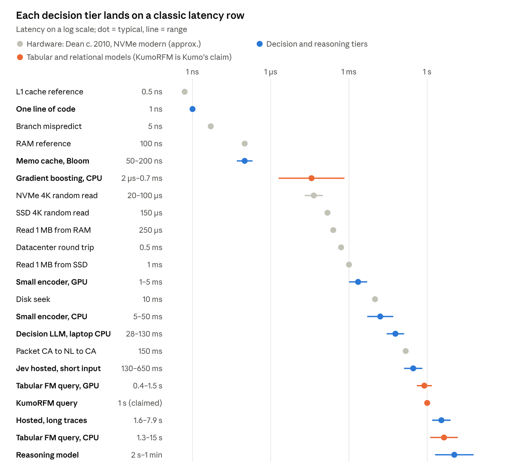
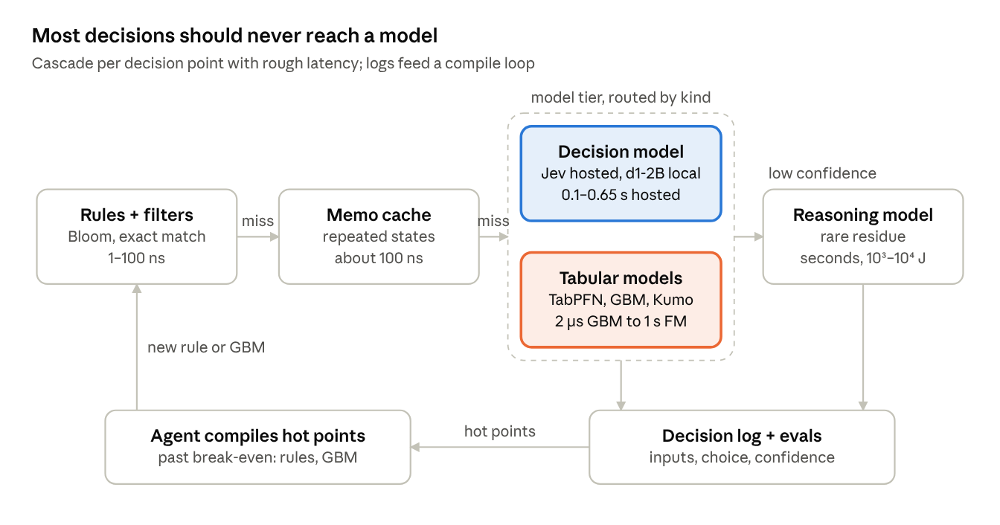

# Decision Points as Effects: Model-Backed Decisions in Kyo Pipelines

*Pre-design doc · started Oct 17, 2026 · last updated Oct 27, 2026 · Vishwas*

## Summary

Treat fuzzy decisions in a program as an effect: answered by rules or caches when possible, by a small decision model when needed, and by a reasoning model only for the rare residue. Model calls behave like IO, so Kyo fibers and micro-batching can hide their latency, but nothing hides their energy or dollar cost.

Headline numbers (order of magnitude, one line of CPU code ≈ 1 ns and ≈ 1 nJ):

- One decision costs about 10⁷–10⁸ lines of blocking latency, near zero when overlapped by fibers.
- One decision costs about 10⁹ lines in energy and in today's dollars.
- In 18–24 months the cost figure drops to about 10⁸ lines; blocking latency to hosted models barely moves.
- At 1 decision per 10⁶ lines, decisions dominate runtime cost by about 1,000x today and 100x in two years.
- Writing 1,000 lines of agent-generated orchestration costs about $1,000, mostly human review. That breaks even against runtime model calls at about 5 × 10⁷ calls today, 5 × 10⁸ in two years.

The design that follows is a JIT for decisions: start as model calls, log them, and compile hot decision points into code once their volume passes break-even.

## Background

Decision models answer a fixed question with a typed choice, score or yes/no plus a confidence, instead of generating text. That makes them cheap, fast and easy to plug into software.

**Jev (TypeSafe AI).** Released 15 September 2026; hosted and proprietary, weights not released. It returns answers in 70–500 ms; TypeSafe claims 20–200x faster and 40–400x cheaper than LLMs. Pricing is $0.042 per million input tokens, with free output. Jev 1.14.0 (14 October) adds better multilingual judgments. Independent replications find accuracy on par with commercial and open-weight alternatives; the clear win is speed.

**Open, self-hostable alternatives.**

| Option | What it is | Fit |
| --- | --- | --- |
| Laya | Apache-2.0 decision model on ModernBERT, 100+ languages, one forward pass | Multilingual work (Jev's docs say it is best in English) |
| Kev | Self-hosted server matching TypeSafe's API | Drop-in for code written against the TypeSafe SDK |
| Bespoke Nimble | Qwen-3.5-9B fine-tuned as a classifier | One small LLM for many tasks |
| DIY | Label log-probabilities from a small local LLM, constrained decoding, or NLI / ModernBERT / SetFit | Full control, no new dependency |

**General local LLMs** (for the reasoning tier): Qwen3.8 27B is the practical pick at 24–32 GB; GPT-OSS 20B or Gemma 4 12B at 16 GB; Laguna S 2.1 or Qwen3.8 Flash Next at 96–128 GB. The top open-weight model, MiMo-V2.6-Pro, needs 8x H200.

**Bloom filters are a complement, not a competitor.** They give exact membership with no false negatives in about 10–100 ns. Learned Bloom filters (Kraska et al., Mitzenmacher) pair a small model with a backup filter to save memory on structured keys. Decision models add a different capability: membership defined by a concept rather than an enumerated set.

**Tabular and relational foundation models (Kumo).** For well-structured data the right tier is neither a decision model nor an LLM. KumoRFM learns in context from many labeled rows and follows foreign-key links across tables, while decision models and LLMs see one serialized record.

|  | Decision model | Frontier LLM | Kumo (relational FM) |
| --- | --- | --- | --- |
| Input | One state (text/JSON) + typed questions | Serialized rows as text | Database or table + a predictive query |
| Learns from | Pre-training only | Pre-training, a few rows in the prompt | Labeled rows in context, plus cross-table structure |
| Best at | Fuzzy judgments about one text | Reasoning, generation | Statistical prediction across rows (churn, fraud, lead scoring) |
| Weak at | Arithmetic, aggregates, other rows | Numbers as tokens, row order, scale | Free text |

Reported results, almost all from Kumo itself:

- RelBench (7 databases, 30 tasks, 103M+ rows): KumoRFM 76.71 AUROC zero-shot, 81.14 fine-tuned, vs. 68.06 for an LLM baseline (Llama 3.2 3B, a small model, not a frontier one).
- SAP SALT: 89% accuracy vs. 75% for data scientists with XGBoost and 63% for LLM + AutoML.
- KumoRFM-2 (April 2026): 79.60 average AUROC on RelBench V1 classification, above the best tabular model by 3.98 points and the best supervised relational model by 1.54.

Caveats: there is no published comparison against a frontier LLM given SQL and Python tools, which would likely close much of the gap. Kumo is hosted, not local, and Nvidia acquired it for $400M+ in June 2026. Its claim of about 1 second to a prediction is time-to-model, not per-call serving latency.

The two kinds compose rather than compete: an October 2026 crash-data study had Kumo Tabular read every coded record while Jev read free-text narratives, with human judgments recalibrating Jev. Kumo's ranking found real coding discrepancies 7–58x more often than random review. In the cascade below, predictions about many rows route to a tabular or relational tier, and judgments about one text route to the decision model.

Sources: [KumoRFM-2 paper](https://arxiv.org/pdf/2604.12596), [What is Kumo AI](https://kumo.ai/resources/learn/what-is-kumo-ai/), [Kumo relational FM announcement](https://kumo.ai/company/news/kumo-relational-foundation-model/), [Kumo Tabular and Jev crash study](https://arxiv.org/pdf/2610.10321), [Nvidia's Kumo acquisition](https://www.beri.net/article/nvidia-kumo-400m-relational-foundation-models-enterprise-structured-data-2026).

**Flat tables and spreadsheets.** On a single sheet Kumo is not the leader; its edge comes from multi-table data.

- **Kumo Tabular** is NVIDIA's separate, publicly downloadable single-table model, distinct from KumoRFM; its docs mark related tables as unsupported. Being downloadable, it can run locally. One review found no reliable public apples-to-apples result showing it beats current TabPFN, CatBoost, LightGBM or XGBoost, and recommended piloting it rather than switching production to it.
- **KumoRFM 2.0** is only claimed by Kumo to be competitive on single tables.
- **TabPFN** leads curated flat-table benchmarks: TabPFN-3.5 Thinking wins 79% of TabArena splits against AutoGluon 1.6 and 82% against its extreme preset. TabPFN-2.5 handles up to 50,000 rows and 2,000 features.
- **Gradient boosting** remains the baseline for large tables and cheap repeated scoring.

| Your data | Best fit |
| --- | --- |
| One sheet, up to tens of thousands of rows, with labels | TabPFN; pilot Kumo Tabular alongside |
| One large sheet, stable repeated scoring | LightGBM, XGBoost or CatBoost |
| Several sheets linked by IDs | Relational data: KumoRFM, which reads the links instead of flattening |
| Free-text cells | Decision model per cell, with scores fed back as columns |
| Ad hoc analysis rather than prediction | Frontier LLM writing pandas or SQL, not reading the sheet as text |

The flattening tax is smallest when the important cross-table features are already known and can be computed in SQL; a relational model earns its place by finding signal nobody engineered.

Sources: [NVIDIA Kumo Tabular review](https://aireiter.com/blog/nvidia-kumo-tabular-review), [Kumo vs TabPFN](https://kumo.ai/resources/learn/comparison/kumo-vs-tabpfn/), [TabPFN vs XGBoost](https://kumo.ai/resources/learn/comparison/tabpfn-vs-xgboost-structured-data/), [TabPFN-3.5 Technical Report](https://arxiv.org/pdf/2609.17895), [TabPFN-2.5 paper](https://arxiv.org/pdf/2511.08667).

## Cost model

Latency is not cost: it measures the critical path, while cost is work done plus resources held. They agree only for single-threaded, compute-bound code with nothing shared or waiting.

Why they diverge for inference:

- **Work vs. span.** Latency ≈ span + work / P; a GPU call can do 10¹⁴ FLOPs or mostly wait in the same 100 ms.
- **Decode is memory-bound.** A 7B fp16 model streams about 14 GB per token, about 5 ms at 3 TB/s, whether the batch is 1 or 64. Batching cuts per-item cost about 64x at nearly the same latency.
- **Waiting is not work.** Network, queueing and rate limits can be most of a hosted call's latency, at zero operations locally.
- **Idle hardware still bills.** The real cost is resource-seconds held.

Better estimates: FLOPs ≈ 2 × parameters × tokens; bytes moved for memory-bound phases; roofline arithmetic intensity; resource-seconds; joules or price per request.

**Unit conversions used throughout.** One line of CPU code ≈ 1 ns on one core and ≈ 1 nJ (cache-friendly; a DRAM miss adds about 1 nJ). A cloud CPU core buys about 10¹⁴ lines per dollar.

| Operation | Latency | Energy | ≈ Lines (energy) |
| --- | --- | --- | --- |
| Predicted / mispredicted branch | <1 ns / 5–10 ns | ≈ 1 nJ | 1 |
| Bloom filter or hash lookup | 10 ns–1 µs | nJ | 1–10 |
| Small encoder (150M), batched on GPU | 1–5 ms | ≈ 0.1 J | ≈ 10⁸ |
| Small encoder on CPU | 5–50 ms | 1–3 J | ≈ 10⁹ |
| Jev-class (assumed a few B params) | 70–500 ms hosted | 1–10 J | 10⁹–10¹⁰ |
| Frontier reasoning call | seconds to minutes | 10³–10⁴ J | 10¹²–10¹³ |

**Dollars.** A Jev decision at list price (500 tokens) ≈ $2 × 10⁻⁵ ≈ 2 × 10⁹ lines. That is about 75x its likely electricity cost, so it is not below energy cost. GPU capex (about $0.85/hour for an H100) runs about 10x electricity (about $0.07/hour), so joules are a floor on real cost, not the whole of it.

**At 1 decision per 10⁶ lines.** 10⁶ lines ≈ 1 mJ; one decision ≈ 0.1–10 J. Decisions use 100–10,000x the energy of the surrounding code. Energy breaks even at about 1 decision per 10⁸ lines for a batched small encoder, 1 per 10¹⁰ for Jev-class.

## Against Dean's latency numbers

Each decision tier lands on a familiar row of Jeff Dean's "Latency Numbers Every Programmer Should Know": a model call is the new disk seek, and a hosted one is a transcontinental packet. His figures here are the classic circa-2010 values, quoted approximately from memory.

**Where it agrees**

- The cascade is a memory hierarchy. Rules, cache, decision model and reasoning model mirror L1, RAM, disk and network: each tier is 10³–10⁶x slower, and misses fall through.
- The playbook carries over: cache, batch, go async, prefetch, keep slow calls off the critical path.

**Where it differs**

- Latency is not cost. A disk seek is mostly waiting; a model call is real compute, local or remote. Hence the energy and dollar columns his table never needed.
- Rates of change. Memory latency has barely moved in a decade; fixed-capability inference falls about 10x a year, so our rows slide up his chart, local models toward datacenter round trip.
- Variance. His rows are tight; model calls, especially hosted ones, have wide tails, so design to p99.

**Tabular and relational models sit at both ends of the chart.**

- **Gradient boosting is the fastest model tier.** A tree ensemble compiled to native code scores one row in about 2 µs; the same model through Python XGBoost takes about 670 µs. That is NVMe-read territory, close to rules and caches.
- **In-context tabular models are slow per call.** They push the whole labeled context through the network on every query: cold single-query inference is about 1.0 s for TabPFNv2 and 1.5 s for TabICLv2 on an H100, and TabPFN 2.5 runs about 1.4 s end to end on GPU. On CPU it is far worse; one test took 15 s vs. 0.5 s on GPU. GPU plus KV caching can cut prediction time well over 100x.
- **Kumo** reports about 1 second to a prediction for KumoRFM, a time-to-model claim. Its online serving promises millisecond scores via a distilled model over precomputed embeddings, but publishes no latency figures.

This makes gradient boosting the natural compile target in the cascade: an in-context or relational model labels the hot decision points, and a small boosted model trained on those labels serves them in microseconds.

Sources: [Timber compiler benchmarks](https://pypi.org/project/timber-compiler/0.2.0/), [Mechanistic study of tabular FMs](https://arxiv.org/pdf/2605.21288), [TabPFN v2.5 uncertainty study](https://arxiv.org/pdf/2606.01427), [Making tabular FM inference faster](https://mindfulmodeler.substack.com/p/making-tabular-foundation-models), [Kumo online serving](https://kumo.ai/docs/fine-tuning/online-serving).

Scaled so one line of code takes one second: a memo-cache hit is about 2 minutes, a Jev call about 3 years, a long reasoning call about a thousand years.

## Measured decision-model latency (October 2026)

Independent tests put hosted decision models 3–12x faster than LLMs on short inputs, not the advertised 40–200x. On long inputs, every model slows to seconds.

| Test | Decision model | LLM | Speedup |
| --- | --- | --- | --- |
| OpenRouter, 60-ticket triage | Jev: 194 ms p50, 633 ms p95 | GPT Luna 1,106 / 2,395 ms; Claude Opus 1,957 / 2,594 ms | 6–10x, equal accuracy |
| LiteLLM, request routing (80 cases × 3) | Jev: 127 ms p50, 231 ms p95 | Claude Haiku 4.5: 688 / 897 ms | 5.4x (3.9x at p95) |
| Independent blog | Jev: 0.39 s | Claude Sonnet 5: 2.46 s; GPT-5 nano (low): 4.83 s | 6.3x vs. Sonnet |
| Phishing test, from France | Jev: 239 ms | 687 ms | 2.9x |
| Hamel and Saha, long agent traces (mean) | Jev 4.33 s, Liquid d1-ultra 1.56 s, Clef Flash 2.09 s, Perplexity 7.85 s | OpenAI Decisions 2.77 s | Not comparable (separate runs) |
| jev (open source), laptop CPU | 28–130 ms locally | Hosted Jev from Europe: 344 ms | Local wins on latency |

**What this changes in the design**

- **Latency scales with input length.** Prefill dominates, so budget each decision point by the size of the state it reads, not by the model alone.
- **Network sets a floor.** One study of 5,721 calls found about 430 ms per call through a gateway. For tight budgets, run locally: the open jev model answers in 28–130 ms on a laptop CPU, but scored 0.50 vs. hosted Jev's 0.69 on a six-rule fraud task.
- **Amdahl's law applies.** Swapping one pipeline step for Jev made the whole system only 15.9% faster; end-to-end gains need the cascade.
- **The cascade is supported.** A Jev-first cascade matched GPT-5.6 Terra's accuracy at 26–28% of the cost and about half the latency.
- **Quality for cost needs threshold tuning.** On Hamel and Saha's trace eval, Perplexity Decider reached F1 0.79 at 0.82 cents per 100 runs and OpenAI Decisions F1 0.87 at 3.72 cents. Tune each model's threshold rather than using the 0.50 default.

Sources: [Hamel's decision-model evals](https://hamel.dev/blog/posts/decision-model-evals/), [OpenRouter: Jev vs LLM](https://openrouter.ai/blog/tutorials/jev-vs-llm-when-to-use-each/), [Jev Explained](https://medium.com/@sayedebad.777/jev-explained-the-ai-model-that-decides-instead-of-writing-77e896f35fcc), [GreenNode: What is Jev?](https://greennode.ai/blog/what-is-jev), [jev wiki](https://github.com/feder-cr/jev/wiki/lead-qualification-with-yes-no-questions).

## Trends and 18–24 month projection

Inference at fixed capability gets cheaper about 10x a year; CPU work about 1.2x. A decision task is fixed capability, so the lines-per-decision ratio closes by roughly 8x a year. Rates are approximate, from published analyses (a16z, Epoch AI), not fresh measurements.

| Driver | Cost drop per year | Source of the gain |
| --- | --- | --- |
| CPU work (lines per $ or J) | 1.1–1.3x | More cores per dollar; single-thread speed and transistor cost roughly flat |
| GPU hardware (FLOPs per $ or J) | 1.3–1.4x | Newer nodes, FP8/FP4 formats |
| Inference at fixed capability | about 10x (studies: 10–50x) | Hardware × serving software × smaller models matching older large ones × price competition |

**Projected lines of code per decision, 18–24 months out.**

| Metric | Today | Central | Range |
| --- | --- | --- | --- |
| Latency, blocking, hosted | 10⁸ | 10⁷·⁵ | 10⁷–10⁸ (network floor) |
| Latency, blocking, local small model | 10⁷ | 10⁶ | 10⁵·⁵–10⁶·⁵ |
| Latency, hidden by fibers | near 0 | near 0 | throughput-bound |
| Energy | 10⁹ | 10⁸ | 10⁷·⁵–10⁸·⁵ |
| Dollars, current pricing | 10⁹ | 10⁸ | 10⁷–10⁸·⁵ |
| Dollars, unsubsidized | 10⁹–10¹⁰ | 10⁸·⁵ | 10⁸–10⁹ |

The gains arrive only if you swap to newer, smaller models; keep the decision layer swappable and an eval set ready. Longer term the curve flattens: algorithmic gains saturate near a task's minimum model size, and even a 10M-parameter model reading 200 tokens costs about 10⁶–10⁷ lines. Expect Jevons' paradox: cheaper decisions mean many more decision points.

## Throughput vs. latency: the cost of urgency

The same model on the same chip has two operating points. Latency-oriented serving pays for idle headroom so each caller gets a fast answer; throughput-oriented serving keeps the hardware saturated and makes callers wait. Cost per decision is hardware cost per hour divided by decisions per hour, and the throughput design attacks both sides: more decisions per hour from batching, a cheaper hour from cheaper hardware, sites and power.

| Dimension | Latency-oriented | Throughput-oriented |
| --- | --- | --- |
| Batch size | Small, to keep time-to-first-token low | Large, to maximize utilization and KV-cache reuse |
| Utilization | Low by design: headroom absorbs bursts and protects p99 | High: queues absorb bursts |
| Hardware | Top-tier HBM GPUs (Movva cites $15–20/hour) | Cheaper throughput parts: RTX Pro Blackwell (GDDR), AMD, TPUs, Trainium |
| Reliability | Redundant power and cooling, high uptime | Low-reliability modular sites; failures handled by checkpoint and resume within 30 s |
| Power | Grid at market price | Can chase cheap or negative-priced power ("follow the sun") |
| Latency | Milliseconds to seconds | Minutes to hours |
| Cost per decision | Baseline | 5–10x lower (batching 2–3x × hardware 2–3x, per Sail) |
| Fits | Interactive agents, request-path decisions | Background agents, evals, labeling, batch mining, RL rollouts |

**Why the gap is structural.** Decode is memory-bound: each step streams the weights once, whether the batch holds 1 sequence or 64, so batching multiplies useful work at nearly the same cost. A latency lane cannot batch deeply without hurting time-to-first-token, and it must run below capacity to protect tail latency. Decision models are almost all prefill (compute-bound, no output tokens), so they batch well and suit compute-dense chips rather than high-bandwidth memory.

**Concurrency is the price of admission.** By Little's law, a throughput lane needs many requests in flight to fill large batches. Kyo fibers supply that cheaply: a few hundred suspended decisions per machine keep a batch lane full while callers do other work.

**An urgency axis for routing.** The cascade routes by kind (text vs. rows) and confidence. Add a third dimension, the deadline each decision point carries:

- **Interactive** (a human or request path waits): fast hosted tiers, small batches.
- **Async** (background agents, compile-loop labeling, eval runs, batch mining): discounted batch inference, large batches, tolerant of retries and failover.

In Kyo terms, the decision effect carries a deadline, and the handler picks the lane.

**Adjusted projection.** A 5–10x async discount on top of the fixed-capability curve lowers the 18–24 month cost figure for async decision points from about 10⁸ lines per decision to about 10⁷, while interactive decision points stay near 10⁸. Break-even for compiling a decision into code rises in step for async workloads, so more decision points can stay as model calls.

Caveats: the 95%+ share of "sleep-time" compute and the 5–10x savings are a founder's projections about his own market, not measurements.

Source: interview with Neil Movva (Sail Research) on asynchronous inference and modular data centers.

## Development cost and break-even

Assume library reuse keeps new code small: 10⁶ lines of reused libraries need about 10³ lines of orchestration, generated by agents. Human understanding, not generation, dominates the cost of those lines.

| Cost component | Estimate | In CPU-line dollars |
| --- | --- | --- |
| Agent generation (1–5M tokens of reading, iterating, testing) | $5–50 | 10¹⁵ |
| Human understanding and review (2–8 hours) | $200–1,500 | 10¹⁶–10¹⁷ |
| Re-understanding on each later change | recurs per change | scales with API surface read |

One written line costs $0.01–1, the price of 10¹²–10¹⁴ executed lines.

**Break-even per decision point** ≈ development cost ÷ per-decision cost:

- Today: $1,000 ÷ $2 × 10⁻⁵ ≈ 5 × 10⁷ calls over the code's lifetime.
- In 18–24 months: about 5 × 10⁸ calls, since inference cheapens faster than human review.

Below break-even, a runtime model call is cheaper than writing and owning the logic. Above it, compile the decision into code. Generation cost falls on the inference curve; human review barely falls, so the cheapest code becomes code nobody needs to read. Typed effect signatures act as compressed context: a reviewer sees what a block can do without reading its body.

## Proposed architecture

Model each fuzzy decision as a Kyo effect with swappable handlers, run as a cascade, and treat the model tier like a JIT's interpreter: logged, profiled, and compiled away where volume justifies it.

Each tier answers what it can; only misses fall through. The decision model is the new tier; its logs drive the compile loop back into rules.

**Latency hiding with fibers.** By Little's law, in-flight decisions = arrival rate × latency. A core at 10⁸–10⁹ lines/s with 1 decision per 10⁶ lines makes 100–1,000 decisions/s; at 100 ms each that is 10–100 in flight per core, so a few hundred fibers per machine. Fiber suspend and resume is well under a microsecond.

**Where hiding breaks down.**

1. It works only when inference runs off the CPU cores (hosted, GPU, NPU). Local CPU inference is compute, not IO.
2. Throughput, not latency, becomes the limit: an unbatched local encoder at 10 ms gives 100 decisions/s per core. Micro-batch suspended fibers' requests into one forward pass, flushing on N items or a few ms.
3. Each task still waits the full latency; avoid model calls on tight sequential chains.
4. Hosted tails and rate limits need timeouts, rate limiting and a deterministic fallback.

**Further reductions.** Memoize on a normalized state; speculate down the likely branch when it is cheap and reversible; prefetch a decision as soon as its inputs are known.

**The compile loop.** Logged model decisions become a labeled test set. When a decision point's lifetime calls pass break-even, an agent generates rules or a tiny distilled model against that set. Low-confidence cases fall back to the model, like a JIT deoptimizing to the interpreter.

### Tiered compilation with concrete models

A JIT has more than one compiler tier: an interpreter starts everything, a baseline compiler takes warm code cheaply, and an optimizing compiler takes hot code. Liquid AI's LFM3 family (released 27 October 2026, open-weight) fills the missing middle tier: a decision model small enough to run locally, plus a base model to fine-tune.

| JIT tier | Role in the cascade | Model options | When a decision point lives here |
| --- | --- | --- | --- |
| Interpreter | Any new decision point; produces labeled logs | Hosted decision models (Jev, Liquid d1 or d1-ultra API, Clef Flash); frontier model via the advisor for the residue | Low volume, criteria still changing, no eval set yet |
| Baseline compiler | Warm points, zero-shot but local | **d1-2B** (text and images) or **d1-Omni-2B** (adds audio): typed questions in one pass with calibrated probabilities; about 1 GB at 4-bit | Data must stay local, the network floor is too slow, or volume makes hosted calls costly |
| Optimizing compiler, fuzzy | Hot points that still need judgment on text | **LFM3-1.7B-Base** fine-tuned on the logged decisions, or d1-2B with tuned thresholds and Platt calibration | Volume past break-even, but rules cannot capture the judgment |
| Optimizing compiler, exact | Hot points that rules or tables can capture | Rules, Bloom filters, gradient boosting compiled to native code (about 2 µs) | Volume past break-even and the logs show a learnable pattern |
| Glue | Routing and tool calls between tiers | **LFM3-1.7B**: leads its size class on IFEval, BFCL and ToolSandbox, 256K context | Small local agents; not the reasoning tier, since it trails larger models on coding and knowledge |
| Deoptimization target | Low-confidence or out-of-distribution cases | Frontier reasoning model | Any tier's confidence falls below its threshold |

**Promotion rules.** A decision point moves down a tier only when all of these hold:

1. Lifetime calls exceed the break-even for that tier's development cost.
2. The candidate tier matches the current tier on the logged eval set at the chosen precision and recall, with its threshold tuned rather than left at 0.50.
3. Its probabilities pass a calibration check (Brier score, reliability plot), or are recalibrated first.
4. It handles the inputs' languages; English results do not transfer to Kannada without testing.

Demotion is automatic: low confidence or a failed check routes the case back up, like a JIT deoptimizing to the interpreter.

**Cost of the baseline tier.** Liquid reports about 3.6B generated tokens per day from one B300 at 1,024 concurrent requests. At an assumed $5–10 per hour of rental, that is about $0.03–0.07 per million tokens, roughly Jev's list price on your own hardware, and it suits the throughput lane.

**Caveats.** All LFM3 figures are Liquid's own. The blog names no license (earlier Liquid models carried a revenue cap) and no Indic languages. Earlier Liquid d1 needed calibration in independent evals while d1-ultra did not, so check d1-2B before promoting anything to it.

Sources: [Introducing LFM3](https://www.liquid.ai/blog/lfm3), [LFM3 family explained](https://www.orcarouter.ai/blog/lfm3-family-release-tri-hybrid), [Hamel and Saha on decision-model evals](https://hamel.dev/blog/posts/decision-model-evals/).

## Worked example: Claude Code's advisor tool

Claude Code's advisor tool is the escalation tier of this cascade applied to coding agents. A cheaper main model does the routine work and consults a stronger advisor at key moments: before committing to an approach, when an error keeps recurring, or before declaring a task done. The advisor receives the full conversation, including every tool call and result, and returns guidance the main model applies before continuing.

| This design | Advisor tool |
| --- | --- |
| Decision model escalates to a reasoning model on low confidence | Main model escalates to the advisor at decision points |
| Escalation set by a calibrated threshold | Escalation decided by the model itself; no setting caps or forces calls |
| Cheap tier handles most calls | Advisor called at decision points, not every turn |

**Setup.** `/advisor opus`, the `advisorModel` setting, or the `--advisor` flag. The advisor must rank at or above the main model: Sonnet main with an Opus advisor works, the reverse does not. It runs server-side on the Anthropic API only and is experimental.

**Cost and latency.**

- Each call bills at the advisor model's rates, on top of the main model's usage.
- Toggling the advisor keeps the main model's prompt cache intact, but the advisor's own read is uncached: every call processes the full transcript fresh. Advisor calls therefore grow with session length, like the long-trace row in the latency chart.
- Calling the stronger model only at decision points typically costs less than running it throughout, the same amortization argument as the cascade.

**The gap.** Escalation is model-driven, not threshold-driven. There is no calibrated confidence score, so there is no precision/recall tradeoff to tune for when it escalates. Measure it empirically instead: log each advisor call and whether its guidance changed the outcome.

**Pairings.** Sonnet main with an Opus advisor for routine work with strong planning; Opus main with a Fable advisor for the hardest design calls.

Source: [Claude Code advisor docs](https://code.claude.com/docs/en/advisor).

## Open questions, risks and next steps

**Open questions**

- What is Jev's real size and architecture? All Jev energy figures here assume a few billion parameters.
- Is current hosted pricing subsidized? Early-access pricing and free output tokens suggest it may be.
- How well do Laya and other open decision models handle Kannada and other non-English text?
- What decision density and lifetime call counts do our actual workloads have?

**Risks**

- Calibration is empirical, not guaranteed; it can drift after quantization or a model swap.
- Hosted calls carry p99 latency and rate limits; a decision on a sequential dependency chain still blocks its task.
- Local CPU inference competes with the code it serves; fibers do not hide compute.
- Projections assume the fixed-capability curve continues; if only hardware improves, gains are about 1.3x a year.

**Next steps**

- [ ] Measure energy on target hardware (RAPL on CPU, NVML on GPU) for one small encoder and one hosted call.
- [ ] Prototype the decision effect in Kyo with rule, cache, local-model and hosted handlers.
- [ ] Add a micro-batching handler (flush on N items or a few ms) and measure throughput vs. fiber count.
- [ ] Log decisions with confidence to build eval sets and find hot decision points.
- [ ] Benchmark Laya and a DIY small-LLM logprob classifier against Jev on one real task, including Kannada text.
- [ ] Define the compile threshold: lifetime calls vs. break-even, re-checked as prices fall.
