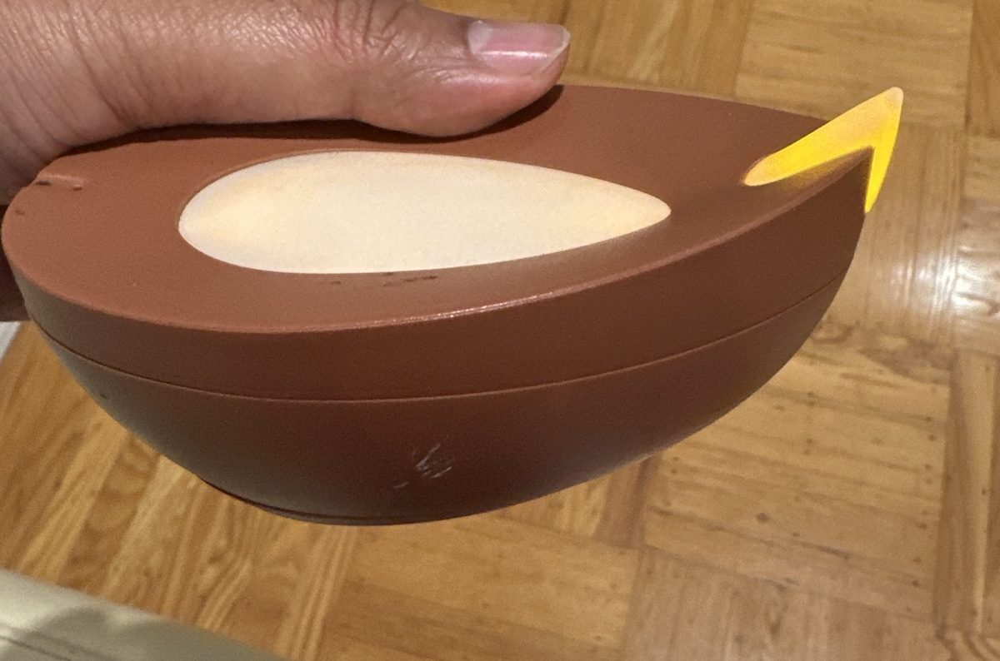
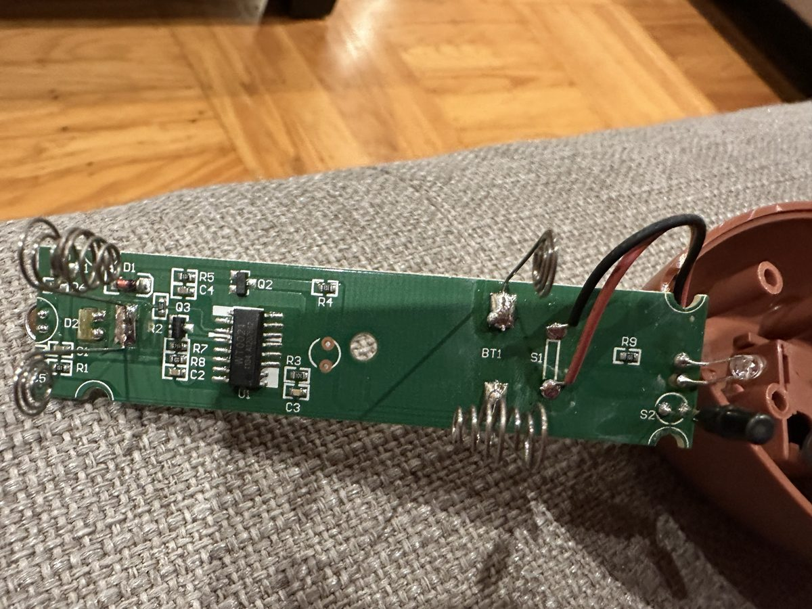
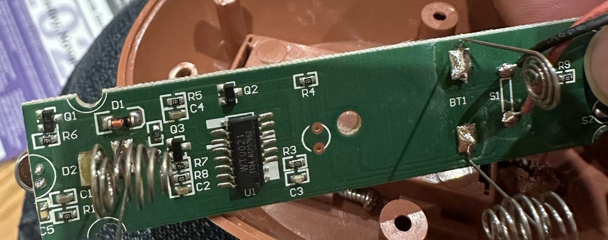
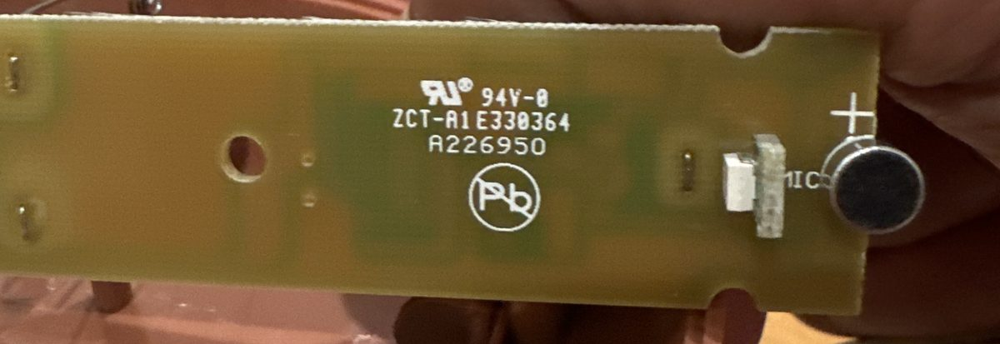
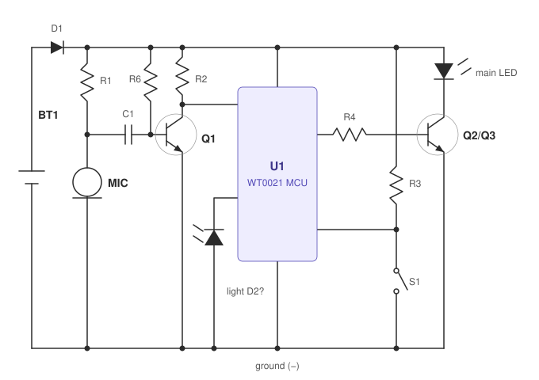

# The Diya That Was Listening

*A Diwali incident postmortem · Nov 6, 2026 · Vishwas*

## Summary

On the eve of Diwali, an electric diya in our house was declared dead. Two adults, one AI model, a phone camera and roughly thirty minutes of reverse engineering were deployed. The diya was not dead. It was waiting for someone to clap.

Severity: **SEV-0 (embarrassment)**. Customer impact: none, except to my dignity.

## Timeline

| Time (PST) | Event |
|---|---|
| Earlier | Diya fails to light. Diagnosis: broken. Confidence: total. |
| Earlier | Diya disassembled. Batteries, springs, and a tiny green circuit board exposed on the couch. |
| 20:17 | I photograph the board and ask an AI, "How does this light work?" |
| 20:18 | AI identifies a microcontroller, two transistors, a button and an LED. Reasonable. Sounds like a light. |
| 20:19 | I request a stick diagram. One is produced, with **one** resistor. |
| 20:23 | I point out the board has **nine** resistors. The diagram grows seven more. |
| 20:28 | I report 4 capacitors, 2 diodes and **3** transistors. Q1 had been hiding under a battery spring the whole time, like a cat under a bed. |
| 20:30 | I flip the board over. On the back, clearly labelled in white silkscreen: **MIC**. |
| 20:31 | The AI, to its credit, immediately pivots: "this is almost certainly a sound-activated light." Schematic redrawn around a microphone preamp. |
| 20:45ish | I make a joke about the absurd over-engineering of a clap-activated clay lamp. Saying it out loud, I remember: it is a clap-activated clay lamp. That is the entire feature. |
| 20:46 | My wife: "Did you try clapping?" |
| 20:46 | I clap. |
| 20:46 | Diya turns on. |
| 20:47 | Incident resolved. Root cause escalated to the household. |

## What we found inside

The board, in its natural habitat (my couch):

On the far left, the hiding Q1 and its 750 kΩ friend R6. Resistors that large are not there to light an LED. They are there to *listen*:

And on the back, the smoking gun, which in retrospect was printed in capital letters:

## How it actually works

This is reconstructed from photos, not traced with a meter, so treat the exact wiring as a confident guess:

1. **Ear.** R1 biases a little electret microphone. C1 lets only the *change* in voltage through, so a clap arrives as a sharp blip.
2. **Amplifier.** Q1, biased by R6 with R2 as its load, turns that blip into something a chip can notice.
3. **Brain.** U1, a 14-pin chip marked `WT0021` with no datasheet anywhere on the internet, decides that the blip was a clap and toggles the flame. It probably also makes it flicker, because a diya that doesn't flicker is just a lamp with ambitions.
4. **Muscle.** Q2/Q3 switch the actual LED, which shines out through a little yellow plastic flame.
5. **Probably-an-eye.** A small sensor near the mic may keep it from reacting in daylight, It is also the one part I'm least sure of.

Total part count: 9 resistors, 4 capacitors, 2 diodes, 3 transistors, 1 microphone, 1 mystery chip. Total part count of a real diya: 1 clay bowl, 1 cotton wick, some ghee.

## Root cause

**Primary:** User error. The device was operating exactly as designed. It was not off. It was *politely waiting to be addressed*.

**Contributing factors:**
- The documentation was printed on the back of the circuit board, inside the case.
- The engineer (me) went straight from "it doesn't light" to "let me reverse-engineer the transistor biasing," skipping the step every non-engineer does first, which is to use the thing.
- The AI did the same, but faster, and with diagrams.

## What went well

- The schematic got progressively more accurate with each photo. We converged on the truth from first principles.
- First principles took 30 minutes. Asking my wife took 4 seconds.

## Action items

| Action | Owner | Status |
|---|---|---|
| Before opening any device, try the thing it is for | Me | Accepted, will regress |
| Before opening any device, ask my wife | Me | **P0** |
| Find a datasheet for `WT0021` | Me | Won't fix |
| Try blowing on it, since some of these diyas use the same mic to "blow out" the flame like a real one | Everyone | Highly anticipated |
| Put the diya back together | Me | Done |

*ದೀಪಾವಳಿಯ ಹಾರೈಕೆಗಳು! Happy Diwali. If your lamp won't light this weekend, clap first.*
